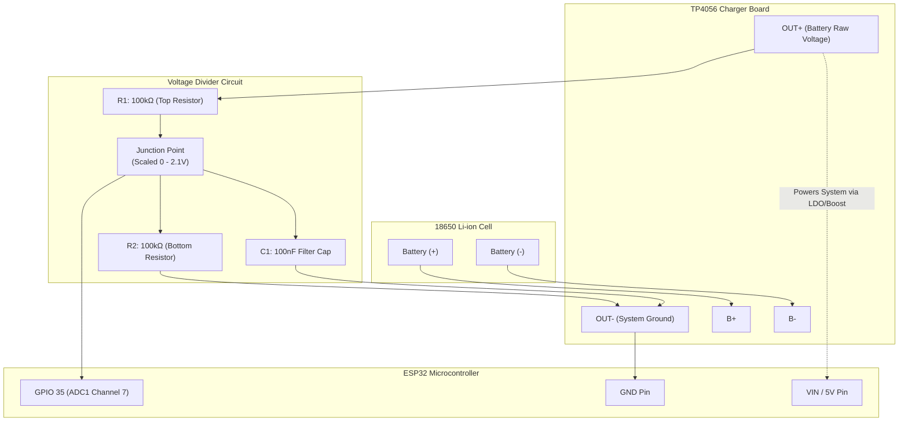

# BeVest Smart Vest — Battery State of Charge (SoC) Implementation Guide

This guide details the hardware wiring, circuit diagram, firmware code, and calibration procedure to accurately measure the **State of Charge (Battery %)** of an 18650 Li-ion battery using the **TP4056 USB-C charging module** and the **ESP32 DevKit**.

---

## 1. Hardware Overview & Circuit Schematic

### Component List
- **Battery**: 1S 18650 Li-ion Cell ($3.0\text{V} - 4.2\text{V}$)
- **Charger Module**: TP4056 (Type-C / Micro-USB) with dual protection (DW01A + 8205A)
- **$R_1$ (Upper Resistor)**: $100\text{ k}\Omega$ (1% tolerance recommended)
- **$R_2$ (Lower Resistor)**: $100\text{ k}\Omega$ (1% tolerance recommended)
- **$C_1$ (Filter Capacitor)**: $100\text{ nF}$ ($0.1\mu\text{F}$) ceramic capacitor
- **Microcontroller**: ESP32 DevKit (measuring on **`GPIO 35`**)

---

### Wiring Diagram & Resistor Placement

```
                      +───────────────────────────────────────────+
                      │          18650 Li-ion Battery             │
                      │          (3.0V Empty ~ 4.2V Full)         │
                      +─────────────┬─────────────────┬───────────+
                                    │ (+)             │ (-)
                                    │                 │
                                    ▼                 ▼
                      +───────────────────────────────────────────+
                      │               TP4056 MODULE               │
                      │  B+                           B-          │
                      │                                           │
                      │  OUT+                         OUT-        │
                      +────┬────────────────────────────┬─────────+
                           │                            │
                           │                            │ (Common GND)
            ┌──────────────┴──────────────┐             │
            │                             │             │
            ▼                             ▼             │
     [5V / 3.3V Regulator]          [ R1: 100kΩ ]       │
            │                             │             │
            ▼                             ├─────────────┼───────────────► ESP32 GPIO 35
     ESP32 5V (VIN) Pin                   │             │                 (ADC1 Channel)
                                    [ R2: 100kΩ ] [ C1: 100nF ]
                                          │             │
                                          └─────────────┴───────────────► ESP32 GND
```



---

## 2. Why This Circuit is Necessary

1. **Voltage Range Protection**:
   - An 18650 battery outputs up to **$4.20\text{V}$** when freshly charged.
   - The ESP32 ADC maximum allowable input voltage is **$3.3\text{V}$** (operating reliably up to $\sim 3.1\text{V}$ at $11\text{dB}$ attenuation). Connecting $4.2\text{V}$ directly will damage the ESP32 pin.
   - The $100\text{k}\Omega : 100\text{k}\Omega$ divider cuts the voltage in half ($2:1$ ratio):
     $$\text{ADC Voltage} = 4.20\text{V} \times \frac{100\text{k}\Omega}{100\text{k}\Omega + 100\text{k}\Omega} = 2.10\text{V}$$
     This sits comfortably within the most accurate zone of the ESP32 ADC.

2. **Low Idle Current Draw**:
   - Total divider resistance is $100\text{k}\Omega + 100\text{k}\Omega = 200\text{k}\Omega$.
   - Current drained by the measuring circuit:
     $$I = \frac{4.2\text{V}}{200\text{k}\Omega} = 21\,\mu\text{A}$$
     This negligible leakage current will not drain your 18650 cell during storage or standby.

3. **Noise Filtering with $C_1$ ($100\text{nF}$)**:
   - ESP32 Wi-Fi causes sudden $250\text{mA}$ current spikes that cause voltage ripple. The capacitor filters out high-frequency noise and stabilizes ADC conversions.

4. **ADC Pin Selection**:
   > [!IMPORTANT]
   > Use **ADC1** pins only (**GPIO 32, 33, 34, 35, 36, 39**).
   > **Never use ADC2 pins** (GPIO 0, 2, 4, 12, 13, 14, 15, 25, 26, 27) because the ESP32 Wi-Fi hardware permanently locks ADC2 during radio transmissions.

---

## 3. 18650 State of Charge (SoC) Curve

Li-ion discharge is non-linear. The table below represents a typical 18650 discharge curve under light wearable load ($\approx 150-250\text{mA}$):

| Cell Voltage ($V_{\text{cell}}$) | ADC Pin Voltage ($V_{\text{pin}}$) | State of Charge (SoC %) | Health / Status |
|:---:|:---:|:---:|:---:|
| **$\ge 4.18\text{ V}$** | $2.09\text{ V}$ | **100%** | Full Charge / Green |
| **$4.05\text{ V}$** | $2.02\text{ V}$ | **90%** | Normal / Green |
| **$3.95\text{ V}$** | $1.97\text{ V}$ | **80%** | Normal / Green |
| **$3.85\text{ V}$** | $1.92\text{ V}$ | **70%** | Normal / Green |
| **$3.78\text{ V}$** | $1.89\text{ V}$ | **60%** | Nominal Plateau / Green |
| **$3.73\text{ V}$** | $1.86\text{ V}$ | **50%** | Nominal Plateau / Green |
| **$3.68\text{ V}$** | $1.84\text{ V}$ | **40%** | Medium / Amber |
| **$3.62\text{ V}$** | $1.81\text{ V}$ | **30%** | Warning / Amber |
| **$3.55\text{ V}$** | $1.77\text{ V}$ | **20%** | Low Battery Warning / Red |
| **$3.45\text{ V}$** | $1.72\text{ V}$ | **10%** | Critical / Red (Buzzer alert) |
| **$3.30\text{ V}$** | $1.65\text{ V}$ | **5%** | Critical / Immediate Re-charge |
| **$\le 3.10\text{ V}$** | $1.55\text{ V}$ | **0%** | Cutoff Threshold |

---

## 4. Firmware Implementation (`esp32integration.ino`)

Add these code blocks to your firmware:

### A. Pin Definitions & Variables (Top of file)
```cpp
// ── Battery ADC Measurement (TP4056 + 100k/100k Divider) ────────────────────
#define BATTERY_ADC_PIN         35       // GPIO 35 (ADC1 Channel 7)
#define VOLTAGE_DIVIDER_RATIO   2.0f     // (R1 + R2) / R2 = (100k + 100k) / 100k
#define ADC_REF_CALIBRATION     1.025f   // Adjust with multimeter calibration
#define BATTERY_SAMPLE_MS       5000     // Sample every 5 seconds

float         batteryVoltage         = 3.85f;
float         filteredBatteryVoltage = 3.85f;
unsigned long lastBatterySampleMs    = 0;
```

### B. Setup Function Configuration
In `setup()`:
```cpp
// Configure ADC attenuation for 0V - 3.1V range on GPIO 35
analogSetPinAttenuation(BATTERY_ADC_PIN, ADC_11db);
analogReadResolution(12); // 12-bit ADC (0 - 4095)
```

### C. Reading & Conversion Functions
```cpp
// ── Read Filtered Battery Voltage (32-sample Oversampling) ───────────────────
float readRawBatteryVoltage() {
  uint32_t rawSum = 0;
  for (int i = 0; i < 32; i++) {
    rawSum += analogRead(BATTERY_ADC_PIN);
    delayMicroseconds(100);
  }
  float pinVoltage = ((float)rawSum / 32.0f / 4095.0f) * 3.3f * ADC_REF_CALIBRATION;
  return pinVoltage * VOLTAGE_DIVIDER_RATIO;
}

// ── Piecewise SoC Lookup Table ───────────────────────────────────────────────
int voltageToBatteryPercent(float v) {
  if (v >= 4.18f) return 100;
  if (v <= 3.10f) return 0;

  const struct { float v; int soc; } lut[] = {
    {4.18f, 100}, {4.05f, 90}, {3.95f, 80}, {3.85f, 70},
    {3.78f, 60},  {3.73f, 50}, {3.68f, 40}, {3.62f, 30},
    {3.55f, 20},  {3.45f, 10}, {3.30f, 5},  {3.10f, 0}
  };

  for (int i = 0; i < 11; i++) {
    if (v >= lut[i + 1].v) {
      float span = lut[i].v - lut[i + 1].v;
      float ratio = (v - lut[i + 1].v) / span;
      return (int)(lut[i + 1].soc + ratio * (lut[i].soc - lut[i + 1].soc));
    }
  }
  return 0;
}

// ── Service Battery State (EMA Filtered) ─────────────────────────────────────
void updateBatteryMeasurement() {
  unsigned long now = millis();
  if (now - lastBatterySampleMs < BATTERY_SAMPLE_MS) return;
  lastBatterySampleMs = now;

  float instantV = readRawBatteryVoltage();

  // Exponential Moving Average filter (alpha = 0.20) to smooth out Wi-Fi spikes
  if (filteredBatteryVoltage < 1.0f) {
    filteredBatteryVoltage = instantV;
  } else {
    filteredBatteryVoltage = (filteredBatteryVoltage * 0.80f) + (instantV * 0.20f);
  }

  batteryVoltage = filteredBatteryVoltage;
  batteryPercent = voltageToBatteryPercent(batteryVoltage);
}
```

### D. Main Loop & Firebase Integration
In `loop()`:
```cpp
updateBatteryMeasurement();
```

In `pushReadingToFirebase()` and `pushVestLiveToFirebase()`:
```cpp
json.set("battery", batteryPercent);
json.set("batteryVoltage", (double)batteryVoltage);
```

---

## 5. One-Time Multimeter Calibration

Because standard $100\text{k}\Omega$ resistors and the internal ESP32 ADC reference have small manufacturing tolerances ($\pm 2\text{--}5\%$):

1. Connect your 18650 battery to the TP4056.
2. Measure the exact battery voltage at the `OUT+` and `OUT-` pads using a digital multimeter (e.g. `3.82V`).
3. Open the Arduino Serial Monitor and check the printed `[STATUS] ... Battery:` output (e.g. `3.74V`).
4. Calculate your calibration factor:
   $$\text{ADC\_REF\_CALIBRATION} = \frac{\text{Multimeter Voltage}}{\text{Reported Voltage}} = \frac{3.82}{3.74} = 1.021$$
5. Update `#define ADC_REF_CALIBRATION 1.021f` in the firmware. Your readings will now match your cell voltage accurately.

