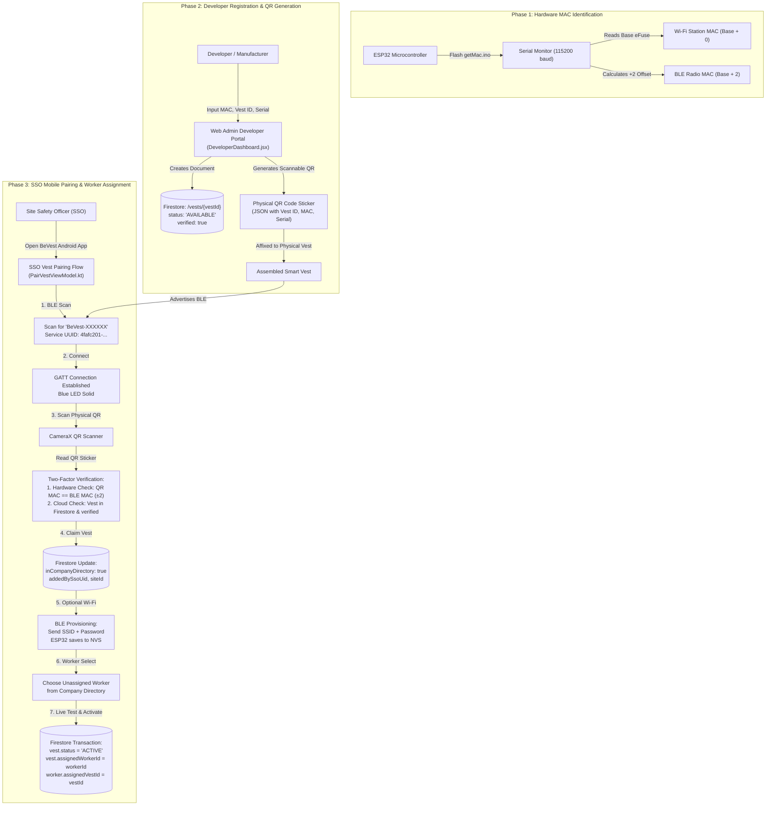

# BeVest — IoT Smart Safety Vest System

**BeVest** is an industrial IoT workplace safety system designed to protect field workers in logistics and construction environments. It integrates wearable smart vest hardware (ESP32 with biometric and environmental sensors), a Site Safety Officer (SSO) Android mobile application, and a centralized web dispatch dashboard powered by Google Firebase.

---

## Repository Structure

```text
BevestV1/
├── app/                    # Native Android Mobile App (Kotlin, Jetpack Compose, CameraX, BLE GATT)
├── firmware/               # Microcontroller source code (ESP32, C++/Arduino)
│   ├── bevest_smart_vest/  # Complete unified smart vest firmware (telemetry + BLE provisioning)
│   ├── getMac.ino          # Hardware MAC diagnostic utility
│   └── esp32integration/   # Legacy individual firmware sketches
├── web-admin/              # React / Vite / Tailwind Web Dashboard & Developer Portal
├── functions/              # Firebase Cloud Functions (Node.js)
├── firestore.rules         # Cloud Firestore security rules
├── database.rules.json     # Firebase Realtime Database rules
└── README.md               # Main repository documentation & Vest Lifecycle Guide
```

---

## BeVest Smart Vest — End-to-End System & Lifecycle Guide

This section provides the complete technical walkthrough of the BeVest Smart Vest lifecycle:
1. **Hardware MAC Extraction**: Reading the ESP32's factory MAC addresses (Wi-Fi STA vs. Bluetooth Low Energy).
2. **Developer Portal & QR Registration**: Cataloging authentic vests into the central Firebase database and generating scannable QR codes.
3. **SSO Mobile App Pairing & Assignment**: How a Site Safety Officer (SSO) discovers, validates, provisions Wi-Fi, and assigns a vest to a field worker.

---

### Architecture & Lifecycle Overview



---

### Phase 1: Obtaining the ESP32 Hardware MAC Address

Every ESP32 chip contains a factory-programmed base MAC address stored in its eFuse controller. The hardware allocates sequential MAC addresses from this base:

| Interface | MAC Offset | Description |
| :--- | :--- | :--- |
| **Wi-Fi Station (STA)** | `Base + 0` | Used for Wi-Fi telemetry transmission to Firebase RTDB. |
| **Wi-Fi SoftAP** | `Base + 1` | Used when the ESP32 hosts its own local access point. |
| **Bluetooth / BLE** | `Base + 2` | Broadcasted over the air during BLE advertising and scanning. |
| **Ethernet** | `Base + 3` | Reserved for wired Ethernet PHYs. |

#### Diagnostic Sketch: `firmware/getMac.ino`

To determine the exact Wi-Fi and BLE MAC addresses of an ESP32 board before assembly:

1. Connect the ESP32 to your computer via USB.
2. Open [`firmware/getMac.ino`](file:///c:/Users/User/Documents/GitHub/BevestV1/firmware/getMac.ino) in Arduino IDE.
3. Select your board (`ESP32 Dev Module`) and COM port.
4. Upload the sketch and open **Serial Monitor** at **115200 baud**.

##### Output Example:
```text
=======================================================
  ESP32 Hardware MAC Address Diagnostic
=======================================================
  1. Wi-Fi Station MAC (Base MAC) : 24:6F:28:B4:9C:10
     Clean Wi-Fi MAC              : 246F28B49C10
     -> Used by Developer Dashboard / Wi-Fi Telemetry
-------------------------------------------------------
  2. Bluetooth Low Energy MAC     : 24:6F:28:B4:9C:12
     Clean BLE MAC                : 246F28B49C12
     -> Detected by Phone during BLE Scan (+2 offset)
=======================================================
```

> [!NOTE]
> The BeVest mobile app and cloud repository contain built-in MAC arithmetic (`Validators.isMatchingEsp32Mac`) that automatically recognizes both `Base + 0` and `Base + 2` as matching hardware. You can register either form in the Developer Portal.

---

### Phase 2: Registering Hardware & Generating QR Codes (Developer Portal)

Only vests pre-cataloged by the system developer can be claimed by company Safety Officers. This prevents rogue or counterfeit hardware from joining company networks.

#### Accessing the Developer Portal
1. Open the BeVest Web Admin application: `https://<your-firebase-app>.web.app/developer`
2. Log in with an account having the **`DEVELOPER`** role (or `developer@bevest.com`).
3. Select the **Hardware Catalog** tab.

#### Single Vest Registration
Fill in the **Hardware QR Generator & Registration** form:
- **Vest ID**: Unique identifier, e.g. `VEST-2026-0001` (can use the random generator).
- **Hardware MAC Address**: Enter the 12-hex character MAC (e.g. `24:6F:28:B4:9C:10`).
- **Serial Number**: Manufacturer serial number, e.g. `BV-SN-246F28B49C10`.
- **Model**: e.g., `Bevest Smart IoT Vest v2.1`.
- **Batch Number**: Production batch, e.g., `BATCH-2026-Q4`.
- **Initial Status**: Set to `AVAILABLE`.

Click **"Save Vest & Download Official Scannable QR"**.

#### What gets stored in Firestore?
A document is created at `/vests/{vestId}` with the following structure:
```json
{
  "vestId": "VEST-2026-0001",
  "id": "VEST-2026-0001",
  "macAddress": "24:6F:28:B4:9C:10",
  "cleanMac": "246F28B49C10",
  "serialNumber": "BV-SN-246F28B49C10",
  "esp32Serial": "BV-SN-246F28B49C10",
  "status": "AVAILABLE",
  "model": "Bevest Smart IoT Vest v2.1",
  "batchNumber": "BATCH-2026-Q4",
  "firmwareVersion": "v1.4.2",
  "hardwareToken": "8A9F22C1",
  "verified": true,
  "battery": 100,
  "online": false,
  "assignedWorkerId": null,
  "inCompanyDirectory": false,
  "createdAt": "2026-11-02T06:00:00Z",
  "createdByEmail": "developer@bevest.com"
}
```

#### QR Code Format
The generated QR code contains a JSON payload:
```json
{
  "vestId": "VEST-2026-0001",
  "mac": "246F28B49C10",
  "macAddress": "24:6F:28:B4:9C:10",
  "serialNumber": "BV-SN-246F28B49C10",
  "verified": true,
  "batch": "BATCH-2026-Q4",
  "mfg": "2026-11-02",
  "token": "8A9F22C1"
}
```

Print or laminate this QR code and affix it directly to the physical vest or ESP32 enclosure.

---

### Phase 3: Site Safety Officer (SSO) Flow on the Mobile App

When a new vest arrives on a construction or logistics site, the **Site Safety Officer (SSO)** connects and assigns the vest using the BeVest Android application.

#### Prerequisites on Phone:
- Bluetooth enabled.
- Location services enabled (required by Android for BLE beacon scanning).
- Camera permission granted (for QR scanning).

---

#### Step-by-Step Mobile Pairing Workflow

##### Step 1: Search for Vest
1. Open the BeVest app and log in as an **SSO**.
2. Tap **Vests** from the bottom navigation bar and select **Add / Pair Vest**.
3. Tap **Find Vest**. The app begins BLE scanning for peripherals advertising the BeVest Service UUID:
   - **Service UUID**: `4fafc201-1fb5-459e-8fcc-c5c9c331914b`
   - **Device Advertised Name**: `BeVest-XXXXXX` (where `XXXXXX` is the last 6 hex characters of the BLE MAC).
4. Nearby vests appear on the screen with their device name and hardware address.

##### Step 2: Connect to Vest
1. Tap **Connect** on the detected vest card.
2. The Android BLE GATT client connects to the ESP32:
   - Discovers characteristics:
     - `CONFIG_CHAR_UUID`: `beb5483e-36e1-4688-b7f5-ea07361b26a8` (Write)
     - `STATUS_CHAR_UUID`: `1c95d5e3-d8f7-413a-bf3d-7a2e5d7be87e` (Notify/Read)
3. Once connected, the ESP32’s onboard LED (GPIO 2) transitions from blinking (pairing mode) to solid.
4. Screen displays **"Vest Connected"** and **"Connection Established"**. Tap **Proceed to Scan QR**.

##### Step 3: Scan Physical QR Code (Two-Factor Hardware Verification)
1. The camera opens. Point the camera at the QR code affixed to the physical vest.
2. The app parses the QR code's JSON payload.
3. **Automated Two-Factor Verification**:
   - **Factor 1 (Hardware Match)**: `Validators.isMatchingEsp32Mac` checks whether the QR code's MAC matches the connected BLE radio (accounting for the $\pm 2$ offset). If an SSO accidentally scans a different vest's sticker, the app immediately blocks the action with:
     > *"Hardware Mismatch! Scanned QR MAC does not match the connected vest. Please scan the QR code physically affixed to the connected vest."*
   - **Factor 2 (Database Legitimacy)**: `VestRepository.claimVest()` queries Firestore `/vests/{vestId}`. It verifies that:
     1. The vest exists and has `verified == true`.
     2. The vest has not already been claimed by another company.
4. When validation passes, the vest is claimed into the SSO's company directory (`inCompanyDirectory: true`, `addedBySsoUid`, `companyId`, `siteId`).

##### Step 4: Site Wi-Fi Provisioning (Optional / Over-The-Air)
1. The SSO enters the local job site's Wi-Fi **SSID** and **Password**.
2. Tap **Send Wi-Fi to Vest**.
3. The mobile app transmits the credentials over BLE to the `CONFIG_CHAR_UUID` characteristic.
4. The ESP32:
   - Receives the JSON configuration.
   - Saves the credentials permanently into **NVS (Non-Volatile Storage)** via the ESP32 `Preferences` library.
   - Attempts to connect to the Wi-Fi router.
   - Once connected, sends a notification back via `STATUS_CHAR_UUID` (`WIFI_CONNECTED:<ip_address>`).
5. *Note*: If the vest already has valid Wi-Fi credentials pre-configured, the SSO can tap **"Skip Wi-Fi & Continue"**.

##### Step 5: Assign to a Field Worker
1. The app loads active workers from the company directory who currently do not have a vest assigned.
2. The SSO has two choices:
   - **Select a Worker**: Tap a worker's name to link the vest directly to them.
   - **Keep Available in Directory**: Save the vest to the company's shared inventory pool for later assignment.

##### Step 6: Live Sensor & Telemetry Sanity Test
1. If a worker was selected, the app runs a live sensor check:
   - **Heart Rate & SpO2**: MAX30102 sensor test.
   - **Body Temperature**: DS18B20 OneWire sensor test.
   - **Motion / Inactivity**: MPU-6050 accelerometer/gyroscope test.
   - **GPS Position**: NEO-6M satellite lock.
   - **Cloud Link**: Confirms data packets are reaching Firebase RTDB.
2. All indicators turn green once active readings are detected.

##### Step 7: Confirmation & Activation
1. The SSO taps **Confirm & Activate Vest**.
2. An atomic Firestore transaction runs:
   - Updates `vests/{vestId}`:
     - `status`: `"ACTIVE"`
     - `assignedWorkerId`: `workerId`
   - Updates `workers/{workerId}`:
     - `assignedVestId`: `vestId`
   - Appends an audit record to `assignmentHistory`.
3. The vest is now fully active. Dispatchers and safety managers can monitor the worker's vitals, location, and fall alerts live on the Web Admin dashboard.

---

### Technical Safeguards & Edge Cases

#### 1. Disconnect on Abort
If an SSO cancels the pairing flow or backs out before completion, the mobile app invokes:
- `PairVestViewModel.disconnectIfNotFinished()` / `disconnectAndRescan()`
- This immediately closes the Android GATT client, prompting the ESP32's `onDisconnect` callback to execute `BLEDevice::startAdvertising()`. The vest instantly reappears in future scans rather than being locked in a connected state.

#### 2. Clearing Wi-Fi & Resetting the ESP32
To unpair or clear the stored Wi-Fi credentials on the ESP32 hardware:
- **Method A (Hardware Double-Click)**: Double-click the **EN / RESET** button within 1.5 seconds. The firmware detects the quick reboot and clears NVS Wi-Fi credentials.
- **Method B (Hold BOOT Button)**: While powered on, hold down the onboard **BOOT** button (GPIO 0) for 3 seconds until the buzzer beeps and the LED flashes rapidly.
- **Method C (Hold SOS Button)**: Hold the external **SOS** button (GPIO 15) for 3 seconds.

---

## Code References

| Component | File Path |
| :--- | :--- |
| **Diagnostic MAC Sketch** | [`firmware/getMac.ino`](file:///c:/Users/User/Documents/GitHub/BevestV1/firmware/getMac.ino) |
| **Main Vest Firmware** | [`firmware/bevest_smart_vest/bevest_smart_vest.ino`](file:///c:/Users/User/Documents/GitHub/BevestV1/firmware/bevest_smart_vest/bevest_smart_vest.ino) |
| **Developer Web Portal** | [`web-admin/src/DeveloperDashboard.jsx`](file:///c:/Users/User/Documents/GitHub/BevestV1/web-admin/src/DeveloperDashboard.jsx) |
| **BLE Provisioner (Android)** | [`app/src/main/java/com/jtexpress/bevest/data/ble/BleProvisioner.kt`](file:///c:/Users/User/Documents/GitHub/BevestV1/app/src/main/java/com/jtexpress/bevest/data/ble/BleProvisioner.kt) |
| **Vest Pairing ViewModel** | [`app/src/main/java/com/jtexpress/bevest/ui/vest/PairVestViewModel.kt`](file:///c:/Users/User/Documents/GitHub/BevestV1/app/src/main/java/com/jtexpress/bevest/ui/vest/PairVestViewModel.kt) |
| **SSO Vest Pairing Screens** | [`app/src/main/java/com/jtexpress/bevest/ui/sso/VestScreens.kt`](file:///c:/Users/User/Documents/GitHub/BevestV1/app/src/main/java/com/jtexpress/bevest/ui/sso/VestScreens.kt) |
| **Vest Repository & Firestore**| [`app/src/main/java/com/jtexpress/bevest/data/repository/VestRepositoryImpl.kt`](file:///c:/Users/User/Documents/GitHub/BevestV1/app/src/main/java/com/jtexpress/bevest/data/repository/VestRepositoryImpl.kt) |
| **MAC Offset Validator** | [`app/src/main/java/com/jtexpress/bevest/utils/Validators.kt`](file:///c:/Users/User/Documents/GitHub/BevestV1/app/src/main/java/com/jtexpress/bevest/utils/Validators.kt) |

