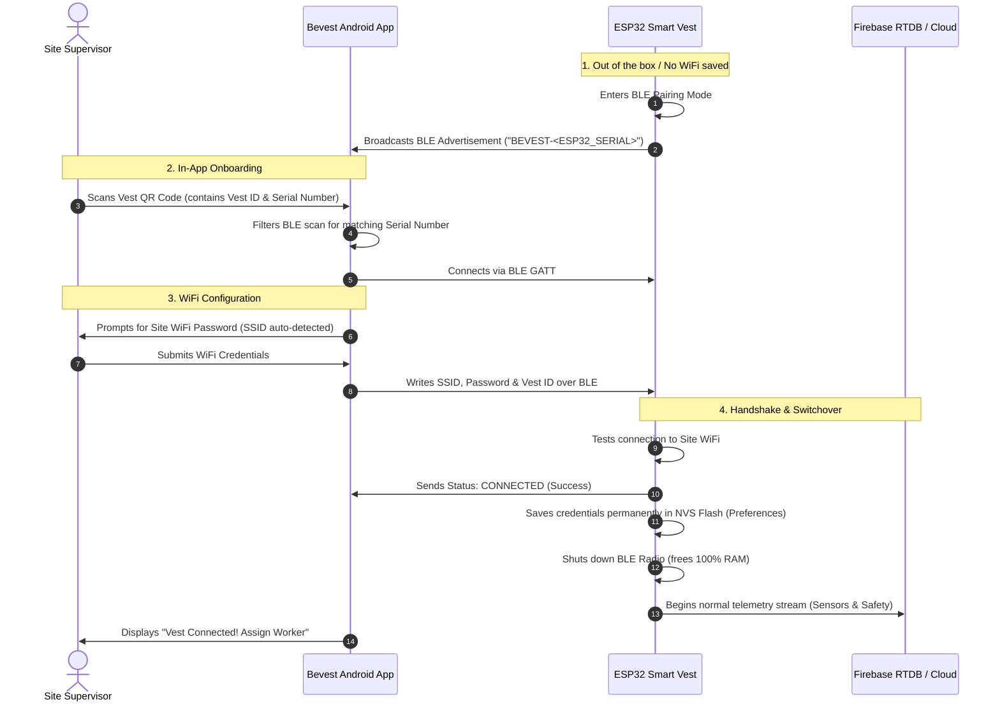

# Bevest Smart Vest — In-App BLE Provisioning Implementation Plan

> **Objective:** Enable seamless, zero-friction WiFi setup for Bevest smart vests when deployed at construction sites. The site supervisor provisions site WiFi credentials directly from the Bevest Android Mobile App over Bluetooth Low Energy (BLE), without captive portals, Arduino IDE, or USB cables.

---

## 1. System Architecture & Workflow



---

## 2. Implementation Phases

```
┌────────────────────────────────────────────────────────────────────────┐
│ PHASE 1: ESP32 Firmware Implementation                                 │
│ 1.1 Add `NimBLE-Arduino` to `platformio.ini`                           │
│ 1.2 Implement NVS Settings Manager (`Preferences.h`)                   │
│ 1.3 Implement BLE GATT Provisioning Service                            │
│ 1.4 Implement Long-Press (5s) Factory Reset Trigger                    │
│ 1.5 Implement BLE Shutdown upon successful WiFi connection             │
└──────────────────────────────────┬─────────────────────────────────────┘
                                   │
                                   ▼
┌────────────────────────────────────────────────────────────────────────┐
│ PHASE 2: Android Mobile Application Implementation                     │
│ 2.1 Add Bluetooth Scan & Connect Permissions in `AndroidManifest.xml`  │
│ 2.2 Create `BleProvisioner` Engine (GATT Client)                       │
│ 2.3 Add "Connect Vest to WiFi" step to `PairVestScreen.kt`             │
│ 2.4 Update `PairVestViewModel.kt` to coordinate BLE provisioning       │
└──────────────────────────────────┬─────────────────────────────────────┘
                                   │
                                   ▼
┌────────────────────────────────────────────────────────────────────────┐
│ PHASE 3: Testing & Quality Assurance                                   │
│ 3.1 Standalone ESP32 BLE verification using nRF Connect                │
│ 3.2 End-to-End Android + ESP32 Provisioning flow                       │
│ 3.3 Multi-Device Collision Test (Multiple vests in one room)           │
│ 3.4 Factory Reset & WiFi credential migration test                     │
└──────────────────────────────────┬─────────────────────────────────────┘
                                   │
                                   ▼
┌────────────────────────────────────────────────────────────────────────┐
│ PHASE 4: Pre-Deployment Manufacturing Integration                      │
│ 4.1 Universal firmware flashing procedure                              │
│ 4.2 Developer Dashboard QR generation & linking checklist              │
└────────────────────────────────────────────────────────────────────────┘
```

---

## Phase 1: ESP32 Firmware Implementation

### 1.1 Dependency Update
Add [`h2zero/NimBLE-Arduino`](https://github.com/h2zero/NimBLE-Arduino) to `firmware/platformio.ini`. NimBLE is ~50% lighter on Flash and RAM than the default Bluedroid stack.

```ini
; firmware/platformio.ini
lib_deps =
    mobizt/Firebase Arduino Client Library for ESP8266 and ESP32@^4.4.14
    h2zero/NimBLE-Arduino@^1.4.1
    paulstoffregen/OneWire@^2.3.7
    milesburton/DallasTemperature@^3.11.0
    adafruit/Adafruit MPU6050@^2.2.6
    adafruit/Adafruit Unified Sensor@^1.1.14
    adafruit/Adafruit BusIO@^1.16.1
    mikalhart/TinyGPSPlus@^1.0.3
```

### 1.2 Persistent Storage Manager (`Preferences.h`)
Create `firmware/src/net/storage.h` and `firmware/src/net/storage.cpp` using the ESP32 Non-Volatile Storage (NVS):
* **Namespace:** `"bevest"`
* **Stored Keys:**
  * `wifi_ssid` (string)
  * `wifi_pass` (string)
  * `vest_id` (string)
  * `configured` (bool)
* **API:**
  * `bool storage::hasCredentials()`
  * `void storage::saveCredentials(const String& ssid, const String& pass, const String& vestId)`
  * `void storage::clearCredentials()` (used on factory reset)

### 1.3 BLE GATT Provisioning Service
Create `firmware/src/net/ble_prov.h` and `firmware/src/net/ble_prov.cpp`:
* **Device Name Advertised:** `BEVEST-<SERIAL_OR_MAC>` (matches QR serial number).
* **Service UUID:** `4fafc201-1fb5-459e-8fcc-c5c9c331914b`
* **Characteristics:**
  * **WiFi Config Characteristic (Write):** `beb5483e-36e1-4688-b7f5-ea07361b26a8`
    * Payload Format (JSON):
      ```json
      {
        "ssid": "Site-Office-WiFi",
        "pass": "SecretPass123",
        "vestId": "VEST-2026-1001",
        "token": "A8B9F012"
      }
      ```
  * **Status Characteristic (Read / Notify):** `1c95d5e3-d8f7-413a-bf3d-7a2e5d7be87e`
    * Status Codes:
      * `0` = IDLE / WAITING_FOR_CREDENTIALS
      * `1` = ATTEMPTING_WIFI_CONNECTION
      * `2` = CONNECTED_SUCCESSFULLY
      * `3` = AUTHENTICATION_FAILED (Wrong Password)
      * `4` = NETWORK_NOT_FOUND

### 1.4 Transition & Memory Freeing
Upon status `2` (`CONNECTED_SUCCESSFULLY`):
1. Write credentials to `Preferences`.
2. Delay 500ms to ensure the BLE notification reaches the phone.
3. Call `NimBLEDevice::deinit(true)` to completely shut down the Bluetooth controller.
4. Hand off execution to `net::begin()` for normal Firebase telemetry.

### 1.5 Physical Reset Trigger
In `firmware/src/logic/safety.cpp`:
* Detect if `PIN_BUTTON` (GPIO 26) is held down for **$\ge$ 5 seconds**.
* Beep buzzer (3 short beeps).
* Call `storage::clearCredentials()` and reboot `ESP.restart()`.

---

## Phase 2: Android Mobile Application Implementation

### 2.1 Bluetooth Permissions
Update `app/src/main/AndroidManifest.xml` to support Android 12+ (API 31+) and legacy Bluetooth:

```xml
<!-- Bluetooth Permissions -->
<uses-permission android:name="android.permission.BLUETOOTH" android:maxSdkVersion="30" />
<uses-permission android:name="android.permission.BLUETOOTH_ADMIN" android:maxSdkVersion="30" />
<uses-permission android:name="android.permission.BLUETOOTH_SCAN" android:usesPermissionFlags="neverForLocation" />
<uses-permission android:name="android.permission.BLUETOOTH_CONNECT" />

<uses-feature android:name="android.hardware.bluetooth_le" android:required="true" />
```

### 2.2 BLE Provisioner Engine
Create `app/src/main/java/com/jtexpress/bevest/data/ble/BleProvisioner.kt`:
* **Scan Filter:** Look for BLE device advertised name matching `BEVEST-<serialNumber>`.
* **Connect:** Connect to GATT server.
* **Write:** Serialize credentials to JSON and write to `WIFI_CONFIG` characteristic.
* **Subscribe:** Listen to `WIFI_STATUS` characteristic.
* Return Kotlin `Flow<ProvisioningStatus>`.

### 2.3 UI & Flow Integration
In `app/src/main/java/com/jtexpress/bevest/ui/vest/PairVestViewModel.kt` & `VestScreens.kt`:

Update `PairStep` enum:
```kotlin
enum class PairStep {
    IDENTIFY,        // 1. Scan QR code
    PROVISION_WIFI,  // 2. Connect via BLE & send WiFi (New Step)
    SELECT_WORKER,   // 3. Assign worker
    CONNECTION_TEST, // 4. Live sensor validation
    DONE             // 5. Complete
}
```

* **Dynamic Step Insertion:** If Firestore reveals the vest is already registered and online, `PROVISION_WIFI` is automatically skipped. If the vest is offline / unprovisioned, `PROVISION_WIFI` triggers automatically.
* **Auto-Fill:** The phone queries its active Wi-Fi network SSID via `WifiManager` so the user only has to type the password.

---

## Phase 3: Testing & Quality Assurance

### 3.1 Standalone ESP32 Test (with nRF Connect App)
1. Flash ESP32 with firmware containing BLE provisioning service.
2. Open **nRF Connect** app (Android / iOS).
3. Confirm advertisement `BEVEST-ESP32-SN-XXXXXX` appears.
4. Connect and write JSON `{"ssid":"...","pass":"..."}` to characteristic.
5. Confirm status `2` (Success) is returned and ESP32 connects to WiFi.

### 3.2 Mobile App Integration Test
1. Generate a test QR on the Developer Dashboard.
2. Scan the QR code using the Bevest Android app.
3. Verify that the app detects the ESP32 via BLE without manual pairing.
4. Input credentials and confirm transition to Worker Assignment.

### 3.3 Multi-Device Collision Test
1. Power on 3 different ESP32 vests in the same room.
2. Scan Vest #2's QR code.
3. Verify that the mobile app only connects to Vest #2 and ignores Vest #1 and Vest #3.

---

## Phase 4: Pre-Deployment Manufacturing Checklist

```
[ ] 1. Flash universal firmware onto ESP32 via USB.
[ ] 2. Read / note ESP32 Serial Number (or MAC address).
[ ] 3. Open Bevest Web Admin -> Developer Dashboard.
[ ] 4. Input ESP32 Serial Number & Generate Vest ID (e.g. VEST-2026-1001).
[ ] 5. Click "Upload & Register to Database" (Saved as AVAILABLE).
[ ] 6. Click "Print Label" -> Print sticker on thermal printer.
[ ] 7. Affix QR sticker to physical vest.
[ ] 8. Box and ship to construction site.
```

---

## Summary of File Changes

| Module | File | Purpose |
| :--- | :--- | :--- |
| **Firmware** | `firmware/platformio.ini` | Add `NimBLE-Arduino` library |
| **Firmware** | `firmware/src/net/storage.h/.cpp` | NVS Preferences for permanent WiFi & Vest ID |
| **Firmware** | `firmware/src/net/ble_prov.h/.cpp` | NimBLE GATT service for WiFi provisioning |
| **Firmware** | `firmware/src/net/net.cpp` | Check NVS on boot before starting Firebase |
| **Firmware** | `firmware/src/logic/safety.cpp` | Add 5-second button press for factory reset |
| **Android App** | `app/src/main/AndroidManifest.xml` | Add BLE runtime permissions |
| **Android App** | `app/.../data/ble/BleProvisioner.kt` | Native Android BLE GATT client |
| **Android App** | `app/.../ui/vest/PairVestViewModel.kt` | State management for BLE provisioning |
| **Android App** | `app/.../ui/sso/VestScreens.kt` | UI for entering WiFi credentials in pairing flow |

