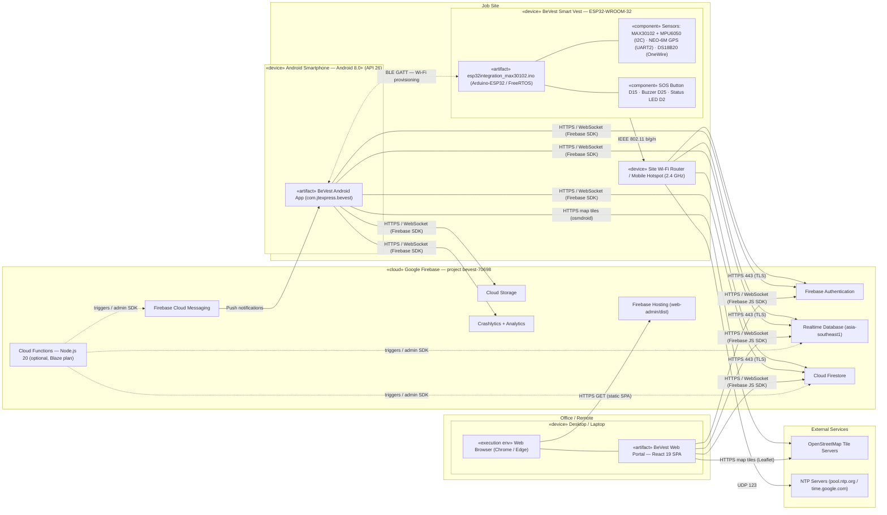
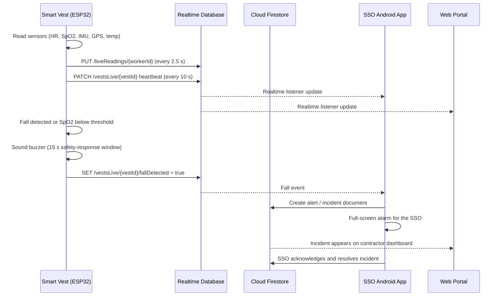
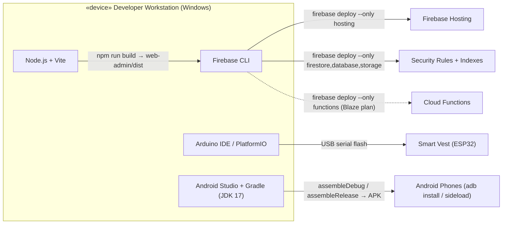

# BeVest Smart IoT Safety System — Deployment Diagram

This document describes how the BeVest system is physically deployed: which hardware and
software nodes exist, which artifacts run on each node, and how the nodes communicate.

---

## 1. Deployment Overview

> **Note:** Cloud Functions (`functions/`) are part of the codebase but require the Firebase
> Blaze (pay-as-you-go) plan. On the free Spark plan, fall detection and escalation run inside
> the SSO Android app (`SafetyWatcher`) instead.

---

## 2. Nodes and Deployed Artifacts

| Node | Type | Execution Environment | Deployed Artifact(s) | Key Libraries / Components |
|---|---|---|---|---|
| **BeVest Smart Vest** | Embedded IoT device | ESP32-WROOM-32, Arduino-ESP32 core on FreeRTOS | `firmware/esp32integration_max30102/esp32integration_max30102.ino` | FirebaseESP32, TinyGPSPlus, Adafruit MPU6050, SparkFun MAX3010x, DallasTemperature, ESP32 BLE |
| **Site Wi-Fi Router / Hotspot** | Network device | 2.4 GHz access point with internet uplink | — | Provides internet access to vests |
| **Android Smartphone** | Mobile client | Android 8.0+ (minSdk 26, targetSdk 34) | `app/` → BeVest APK (`com.jtexpress.bevest`) | Jetpack Compose, Hilt, Navigation Compose, Firebase BoM 32.8.1, osmdroid 6.1.18, CameraX + ML Kit Barcode, DataStore, BLE provisioner |
| **Desktop / Laptop** | Web client | Modern web browser | `web-admin/` → React SPA served by Firebase Hosting | React 19, Vite, Firebase JS SDK 13, Chart.js, Leaflet, qrcode |
| **Firebase Cloud** | PaaS (Google Cloud) | Managed Firebase services | `firebase.json`, `firestore.rules`, `firestore.indexes.json`, `database.rules.json`, `storage.rules`, `web-admin/dist` | Auth, Firestore, Realtime Database, Hosting, Cloud Storage, FCM, Crashlytics, Analytics |
| **Cloud Functions** *(optional)* | Serverless runtime | Node.js 20 | `functions/` (TypeScript → `lib/index.js`) | firebase-admin 12, firebase-functions 5 |
| **OpenStreetMap** | External service | Public tile servers | — | Map tiles for Android (osmdroid) and Web (Leaflet) |
| **NTP Servers** | External service | `pool.ntp.org`, `time.google.com` | — | UTC time sync for vest timestamps and TLS |

### Smart Vest Hardware Wiring

| Component | Interface | ESP32 Pin(s) | Purpose |
|---|---|---|---|
| MAX30102 Pulse Oximeter | I2C | SDA GPIO21, SCL GPIO22 | Heart rate and SpO2 |
| MPU6050 6-DoF IMU | I2C (shared bus) | SDA GPIO21, SCL GPIO22 | Fall and motion detection |
| GY-GPS6MV2 (NEO-6M) | UART2 @ 9600 baud | RX2 GPIO16 ← GPS TX, TX2 GPIO17 → GPS RX | Latitude / longitude |
| DS18B20 Thermometer | OneWire | GPIO4 | Body temperature |
| SOS / Safety Button | Digital input (pull-up) | GPIO15 | 1-click safety response, 3 s hold worker SOS |
| BOOT Button | Digital input (pull-up) | GPIO0 | 3 s hold device reset |
| Active Buzzer | Digital output | GPIO25 | Siren / audible alarm |
| On-board LED | Digital output | GPIO2 | BLE pairing / online indicator |

---

## 3. Communication Paths

| # | From → To | Protocol / Port | Purpose |
|---|---|---|---|
| 1 | Android App ↔ Vest | Bluetooth Low Energy GATT (service `4fafc201-…`, config and status characteristics) | Pair the vest and provision Wi-Fi credentials |
| 2 | Vest → Wi-Fi Router | IEEE 802.11 b/g/n (2.4 GHz) | Network access |
| 3 | Vest → Firebase Auth | HTTPS 443 | Sign in with the shared device account (`vest@bevest.com`) and refresh ID tokens |
| 4 | Vest → Realtime Database | HTTPS 443 (REST, TLS) | Push telemetry and presence; read Wi-Fi commands and worker assignment |
| 5 | Vest → Cloud Firestore | HTTPS 443 (REST) | Sync online/offline presence to the vest document |
| 6 | Vest → NTP | UDP 123 | Sync UTC time |
| 7 | Android App ↔ Firebase | HTTPS / gRPC / WebSocket 443 | Auth, Firestore, RTDB listeners, Storage, Crashlytics |
| 8 | FCM → Android App | FCM (HTTPS / persistent connection) | Alert and incident push notifications with deep links (sent by Cloud Functions; on the Spark plan the app's watchers raise local notifications instead) |
| 9 | Browser → Firebase Hosting | HTTPS 443 | Download the static React SPA |
| 10 | Web Portal ↔ Firebase | HTTPS / WebSocket 443 | Auth, Firestore queries, RTDB live vitals |
| 11 | Android App / Web Portal → OpenStreetMap | HTTPS 443 | Map tiles for live worker locations |

### Realtime Database Paths Written by the Vest

| Path | Interval | Contents |
|---|---|---|
| `/liveReadings/{workerId}` | every 2.5 s | Heart rate, SpO2, temperature, motion, GPS, battery (read by the Android app) |
| `/liveReadingsByVest/{vestId}` | every 2.5 s | Same telemetry keyed by vest |
| `/vestsLive/{vestId}` | every 10 s (heartbeat) + on events | `online`, `fallDetected`, `safetyResponse`, `wifiCommand`, GPS |
| `/vestsLiveByMac/{mac}` | every 10 s + on events | Same status keyed by the ESP32 MAC address; `assignedWorkerId` lookup |

> **Tip:** Several vests can run at the same time with the shared device account. Each vest
> is told apart by its `vestId` and ESP32 MAC address, not by the login.

---

## 4. Runtime Data Flow (Alert Scenario)

---

## 5. Build and Release Pipeline

### Deployment Commands

| Target | Command / Action |
|---|---|
| Vest firmware | Open `firmware/esp32integration_max30102/esp32integration_max30102.ino` in Arduino IDE → Board: **ESP32 Dev Module** → Upload over USB |
| Android app (debug) | `$env:JAVA_HOME = "C:\Users\User\.jdks\jbr-17.0.14"; .\gradlew.bat assembleDebug` |
| Android app (release) | `.\gradlew.bat assembleRelease` → install the signed APK on SSO / contractor phones |
| Web portal | `npm --prefix web-admin run build` then `firebase deploy --only hosting` |
| Security rules and indexes | `firebase deploy --only firestore,database,storage` |
| Cloud Functions *(optional)* | `npm --prefix functions run build` then `firebase deploy --only functions` |

---

## 6. User Roles per Client Node

| Role | Client Node | Main Capabilities |
|---|---|---|
| **Field Worker** | Smart Vest | Wears the vest; SOS / safety-response button |
| **Site Safety Officer (SSO)** | Android App | Live vitals, live map, alerts and incidents, vest pairing (BLE / QR) |
| **Contractor** | Android App, Web Portal | Site overview, SSO management, monthly reports, subscription |
| **Web Admin** | Android App, Web Portal | User management, vest directory oversight |
| **Developer** | Web Portal | Vest hardware catalog and QR generation, admin accounts, subscription tiers, troubleshooting |
