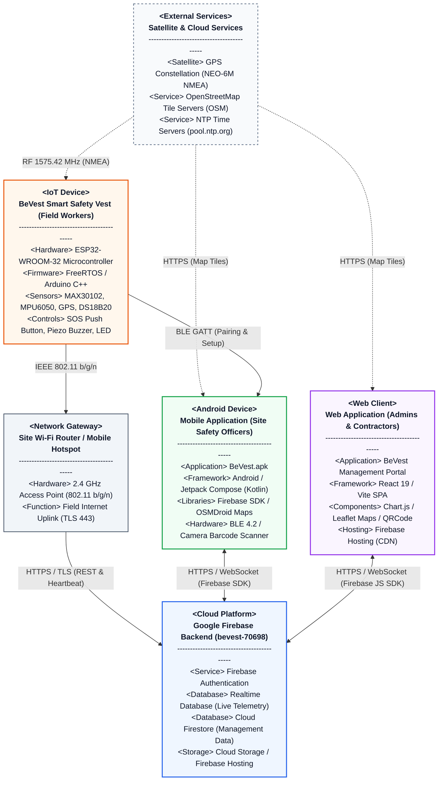

# BeVest Smart IoT Safety System — Simple Deployment Diagram

This document presents a streamlined, academic-style **Deployment Diagram** for the **BeVest Smart Safety System**, modeled after industry-standard UML deployment specifications.

---

## 1. Visual Deployment Diagram



<div align="center">
  <b>Figure: BeVest System Deployment Diagram</b>
</div>

---

## 2. Text-Based Architecture View

For quick reference or viewing in text-only environments:

```
                          +-------------------------------------------------------+
                          |                  <External Services>                  |
                          |   GPS Satellites | OpenStreetMap | NTP Time Servers   |
                          +-------------------------------------------------------+
                                     :                            :          :
                     RF Signals (GPS):             Map Tiles (OSM):          : Map Tiles (OSM)
                                     v                            v          v
+------------------------------------+   BLE Pairing   +---------------------+
|             <IoT Device>           |---------------->|   <Android Device>  |
|      BeVest Smart Safety Vest      |                 |   Site Safety App   |
| ---------------------------------- |                 | ------------------- |
| • ESP32-WROOM-32 Microcontroller   |                 | • BeVest.apk        |
| • MAX30102 (Heart Rate & SpO2)     |                 | • Jetpack Compose   |
| • MPU6050 (Fall & Motion IMU)      |                 | • OSMDroid Map      |
| • NEO-6M (GPS Location Module)     |                 | • BLE Provisioner   |
| • DS18B20 (Body Temperature)       |                 +---------------------+
| • SOS Button, Buzzer, Status LED   |                            |
+------------------------------------+                            |
                  |                                               |
         Wi-Fi    | (802.11 b/g/n)                                |
                  v                                               |
+------------------------------------+                            |
|         <Network Gateway>          |                            |
| Site Wi-Fi Router / Mobile Hotspot |                            |
+------------------------------------+                            |
                  |                                               |
            HTTPS | (TLS 443)                                     | HTTPS / WebSockets
                  v                                               | (Firebase SDK)
+-------------------------------------------------------+         |
|                    <Cloud Platform>                   |<--------+
|          Google Firebase Backend (bevest-70698)       |
| ----------------------------------------------------- |
| • Firebase Authentication (Role-based access)         |
| • Realtime Database (Live Telemetry & Fall Alerts)    |<--------+
| • Cloud Firestore (Workers, Vests, Sites, Reports)    |         |
| • Firebase Hosting & Cloud Storage                    |         | HTTPS / WebSockets
+-------------------------------------------------------+         | (Firebase JS SDK)
                                                                  |
                                                       +---------------------+
                                                       |     <Web Client>    |
                                                       | Web Admin & Portal  |
                                                       | ------------------- |
                                                       | • React 19 / Vite   |
                                                       | • Contractor Portal |
                                                       | • System Management |
                                                       | • Leaflet Maps      |
                                                       +---------------------+
```

---

## 3. Deployment Nodes Specification

| Node Stereotype | Hardware / Execution Node | Key Artifacts & Components | Communication Protocols |
| :--- | :--- | :--- | :--- |
| **`«IoT Device»`** | **ESP32-WROOM-32**<br/>(Wearable Smart Safety Vest) | • `esp32integration_max30102.ino`<br/>• MAX30102 (Heart Rate / SpO2)<br/>• MPU6050 (Fall / Motion Detection)<br/>• GY-GPS6MV2 / NEO-6M (GPS)<br/>• DS18B20 (Temperature)<br/>• SOS Button (D15) & Buzzer (D25) | • **Wi-Fi 802.11 b/g/n** (to Router)<br/>• **BLE 4.2 GATT** (to Android App)<br/>• **RF 1575.42 MHz** (from GPS) |
| **`«Network Gateway»`** | **Site Wi-Fi Router / Hotspot**<br/>(Field Infrastructure) | • 2.4 GHz Access Point<br/>• Cellular / Broadband Internet Uplink | • **WPA2 / WPA3** local Wi-Fi<br/>• **HTTPS / TLS 443** outbound |
| **`«Cloud Platform»`** | **Google Firebase**<br/>(Project: `bevest-70698`) | • **Firebase Authentication**<br/>• **Realtime Database** (`/liveReadings`, `/vestsLive`)<br/>• **Cloud Firestore** (`users`, `vests`, `workers`, `sites`)<br/>• **Firebase Hosting** (`web-admin/dist`) | • **HTTPS / REST (TLS 443)**<br/>• **Secure WebSockets (WSS)** |
| **`«Android Device»`** | **Android Smartphone**<br/>(Site Safety Officers) | • `BeVest.apk`<br/>• Kotlin / Jetpack Compose UI<br/>• OSMDroid Map View<br/>• BLE Provisioner & QR Camera Scanner | • **HTTPS / WebSocket** (Firebase)<br/>• **BLE 4.2** (Vest Pairing)<br/>• **HTTPS** (OSM Tiles) |
| **`«Web Client»`** | **Desktop / Workstation Browser**<br/>(Contractors & Admins) | • Single Page Application (SPA)<br/>• React 19 + Vite<br/>• Leaflet OpenStreetMap<br/>• Chart.js Incident Analytics | • **HTTPS** (Firebase Hosting)<br/>• **HTTPS / WebSocket** (Firebase JS)<br/>• **HTTPS** (OSM Tiles) |
| **`«External Services»`** | **Satellite & Cloud Providers** | • GPS Satellite Constellation (US DOD)<br/>• OpenStreetMap Public Tile Servers<br/>• NTP Servers (`pool.ntp.org`) | • **RF Broadcast** (L1 Band)<br/>• **HTTPS** (PNG Tiles)<br/>• **UDP 123** (Time Sync) |

---

## 4. Key Architectural Highlights

1. **Lightweight Edge-to-Cloud Pipeline**:
   The smart vest processes fall detection and biometric threshold alerts directly on the ESP32 microcontroller, pushing immediate telemetry every 2.5 seconds to Firebase Realtime Database.
2. **Offline-Resilient Mobile Pairing**:
   Site Safety Officers provision Wi-Fi credentials to the smart vest via **Bluetooth Low Energy (BLE)** directly from the mobile app without requiring pre-configured site networks.
3. **Low-Latency Supervision**:
   Safety officers receive audible alarms on Android devices within sub-second latency via Firebase Realtime Database WebSocket listeners whenever a fall or biometric emergency is flagged.

