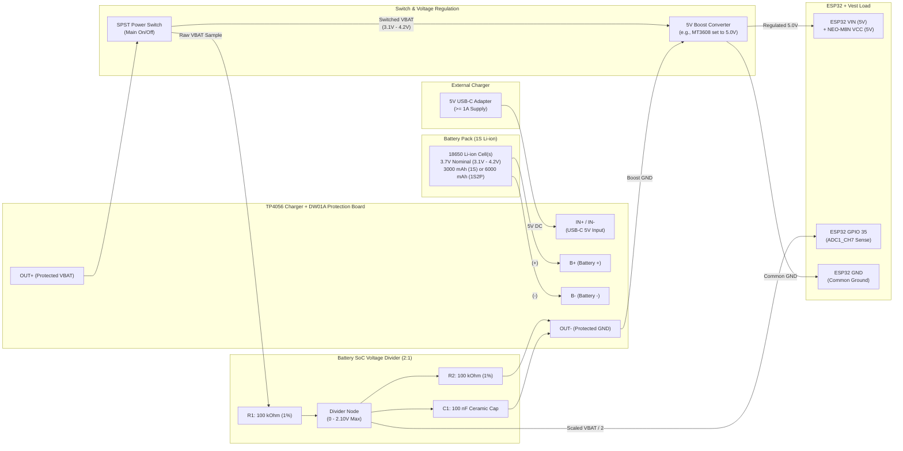

# BeVest Smart IoT Vest — TP4056 Charger, 18650 Battery Wiring & Battery Life Calculation

This separate power guide covers the complete **TP4056 USB-C Li-ion charging/protection module**, **18650 battery wiring**, **5V regulation**, **GPIO 35 Battery SoC sensing circuit**, and **step-by-step battery life & charge-time calculations** for the BeVest Smart Vest running [`esp32integration-gnss.ino`](./esp32integration-gnss.ino).

> [!NOTE]
> For sensor, GNSS (`NEO-M8N`), button, LED, and buzzer connections, see the main hardware diagram: [`WIRING_DIAGRAM.md`](./WIRING_DIAGRAM.md).

---

## 1. Power & Charging Wiring Diagram (TP4056 + 18650 + Boost + Voltage Divider)

### Complete Power Subsystem Diagram (Mermaid)



### Physical Circuit Schematic (ASCII)

```text
                      +-----------------------------------------------+
                      |        5V USB-C Charger (Charging Only)       |
                      +-----------------------+-----------------------+
                                              | (USB-C Port / IN+ & IN-)
                                              v
+----------------------+        +-------------------------------------+
| 18650 Li-ion Battery |  (+)   |           TP4056 MODULE             |
|   3.7V Nominal       |------->| B+        (with DW01A + 8205A)      |
|   (3.1V - 4.2V Max)  |  (-)   | B-                                  |
|   e.g. 3000 mAh      |------->|                                     |
+----------------------+        | OUT+                         OUT-   |
                                +--+-----------------------------+----+
                                   |                             |
                          [ SPST Power Switch ]                  | (Common Protected GND)
                                   |                             |
             +---------------------+---------------------+       |
             | (Pre-Boost VBAT: 3.1V - 4.2V)             |       |
             v                                           v       |
  +---------------------+                         [ R1: 100kΩ ]  |
  | 5V Boost Converter  |                                |       |
  | (MT3608 -> 5.00V)   |                                +-------+------> ESP32 GPIO 35 (ADC1)
  | IN+             IN- |------------------------+       |       |
  | VOUT+         VOUT- |                        | [ R2: 100kΩ ] [ C1: 100nF ]
  +--+---------------+--+                        |       |       |
     | (5.0V)        +---------------------------+-------+-------+------> ESP32 GND (Common)
     |
     +------------------------------------------------------------------> ESP32 VIN (5V)
                                                                          & NEO-M8N VCC (5V)
```

---

## 2. Component & Terminal Connection Table

| Module / Part | Pin / Terminal | Connects To | Purpose / Notes |
| :--- | :--- | :--- | :--- |
| **18650 Li-ion Battery** | Positive (`+`) | `TP4056 B+` | Cell positive terminal (never exceed 1S `4.2V` on TP4056) |
| | Negative (`-`) | `TP4056 B-` | Cell negative terminal (monitored by DW01A protection IC) |
| **TP4056 Charger Board** | `IN+` / `IN-` (USB-C) | `5V` USB Adapter | Charges battery at up to `1000 mA` (default $R_{\text{PROG}} = 1.2\text{ k}\Omega$) |
| *(Red LED = Charging, Blue/Green LED = Full)* | `OUT+` | `SPST Power Switch` $\rightarrow$ Boost `IN+` & `R1` | Protected cell voltage (`~2.5V–4.2V`, cuts off on short/over-discharge) |
| | `OUT-` | Boost `IN-`, `R2`, `C1`, `ESP32 GND` | **Protected Ground.** All system GNDs must return here |
| **SPST Power Switch** | Terminal 1 $\leftrightarrow$ 2 | `TP4056 OUT+` $\leftrightarrow$ Boost `IN+` & `R1` | Isolates vest load during charging and prevents idle divider drain |
| **5V Boost Converter** *(MT3608)* | `IN+` / `IN-` | Switch Output / `TP4056 OUT-` | Steps `3.1V–4.2V` up to steady `5.00V` |
| | `VOUT+` / `VOUT-` | `ESP32 VIN (5V)` & `NEO-M8N VCC` / `GND` | Prevents AMS1117 dropout & Wi-Fi brownouts below `4.2V` |
| **Voltage Divider** *(SoC Sense)* | $R_1 = 100\text{ k}\Omega$ (1%) | Switch Output (`OUT+`) to `GPIO 35` | Halves `4.20V` max battery voltage to `2.10V` safe ADC input |
| | $R_2 = 100\text{ k}\Omega$ (1%) | `GPIO 35` to `GND` (`OUT-`) | Completes $2:1$ resistor divider ($\approx 21\ \mu\text{A}$ load) |
| | $C_1 = 100\text{ nF}$ (`0.1 µF`) | `GPIO 35` to `GND` (`OUT-`) | Smooths Wi-Fi `250–350 mA` TX current ripple for clean ADC reads |

---

## 3. Essential Hardware Design Rules & Warnings

1. **Always Connect Load & Ground to `OUT+` / `OUT-` (Never `B+` / `B-`)**:
   - On protected TP4056 boards, `B-` connects directly to the battery negative, while `OUT-` sits behind the `FS8205A` dual MOSFET switch controlled by the `DW01A` protection IC.
   - Connecting the boost converter or `ESP32 GND` directly to `B-` bypasses over-discharge (`< 2.5V`) and short-circuit protection.
2. **Why a 5V Boost Converter (MT3608) Is Needed**:
   - An ESP32 DevKit V1 regulates `VIN` down to `3.3V` using an onboard LDO (commonly `AMS1117-3.3`, with `~1.1V` dropout). Feeding raw `3.7V` directly into `VIN` drops the internal `3.3V` rail to `~2.6V`, triggering constant brownout resets when Wi-Fi transmits (`WIFI_POWER_19_5dBm`).
   - Additionally, `test_gnss.ino` and the `u-blox NEO-M8N` active antenna module are powered from `5V` (`VIN`).
   - Pre-adjust the MT3608 potentiometer with a multimeter to **`5.00 V`** *before* connecting the ESP32.
3. **Why the Power Switch Matters During TP4056 Charging**:
   - A standard TP4056 board does **not** include an automatic MOSFET load-sharing (power-path) circuit. If the vest remains switched ON while plugged into USB-C, the ESP32 (`~300 mA` battery-side draw) steals charging current and prevents the TP4056 from sensing the $C/10$ (`100 mA`) charge-termination threshold.
   - **Rule**: Turn the vest **Power Switch OFF** when charging via the TP4056 USB-C port (unless adding an external P-MOSFET + Schottky load-sharing circuit).
4. **Never Connect Cells in Series (2S) to TP4056**:
   - TP4056 is strictly a **single-cell (1S, 4.2V)** charger. If longer runtime is needed, wire matched 18650 cells **in parallel (1S2P)** only after voltage-matching both cells within $\le 0.05\text{ V}$.
5. **Tap the ADC Voltage Divider BEFORE the Boost Converter**:
   - $R_1$ must connect to the switched `TP4056 OUT+` node (`3.1V–4.2V`), **not** the boosted `5.0V` output (otherwise the ESP32 reads a constant `5.0V` until cutoff).
   - Use **`GPIO 35` (`ADC1`)** only — ADC2 pins cannot be read while Wi-Fi is active.

---

## 4. Battery State-of-Charge (SoC) & Divider Math

The $100\text{ k}\Omega / 100\text{ k}\Omega$ divider scales cell voltage by $1/2$:

$$V_{\text{ADC}} = V_{\text{bat}} \times \frac{R_2}{R_1 + R_2} = V_{\text{bat}} \times \frac{100\text{ k}\Omega}{100\text{ k}\Omega + 100\text{ k}\Omega} = 0.5 \times V_{\text{bat}}$$

$$V_{\text{bat}} = V_{\text{ADC}} \times \text{VBAT\_DIVIDER} \quad (\text{where } \text{VBAT\_DIVIDER} = 2.0)$$

| 18650 Cell Voltage ($V_{\text{bat}}$) | `GPIO 35` ADC Voltage ($V_{\text{ADC}}$) | Estimated SoC (%) | Operating Zone |
| :---: | :---: | :---: | :--- |
| $\ge 4.18\text{ V}$ | $2.09\text{ V}$ | **100%** | Full Charge |
| $3.95\text{ V}$ | $1.975\text{ V}$ | **80%** | Normal |
| $3.78\text{ V}$ | $1.89\text{ V}$ | **60%** | Nominal Plateau |
| $3.73\text{ V}$ | $1.865\text{ V}$ | **50%** | Nominal Plateau |
| $3.62\text{ V}$ | $1.81\text{ V}$ | **30%** | Warning Threshold |
| $3.55\text{ V}$ | $1.775\text{ V}$ | **20%** | Low Battery Alert |
| $3.30\text{ V}$ | $1.65\text{ V}$ | **5%** | Critical — Recharge Immediately |
| $\le 3.10\text{ V}$ | $1.55\text{ V}$ | **0%** | Cutoff / Software Shutdown Threshold |

> [!TIP]
> Firmware implementation details (32-sample oversampling, `0.20` EMA filter, piecewise SoC lookup table, and multimeter `ADC_REF_CALIBRATION`) are documented in [`BATTERY_SOC_IMPLEMENTATION.md`](../../BATTERY_SOC_IMPLEMENTATION.md). Note that [`esp32integration-gnss.ino`](./esp32integration-gnss.ino) currently keeps a placeholder `batteryPercent = 95` until that ADC block is enabled.

---

## 5. Calculating the Battery Life

### Step 1: Component Current Budget (`esp32integration-gnss.ino`)

The latest Multi-GNSS firmware operates with Wi-Fi modem sleep **disabled** (`WiFi.setSleep(false)`), maximum TX output (`WIFI_POWER_19_5dBm`), concurrent Multi-GNSS reception (`GPS + GLONASS + Galileo + SBAS`), and 2.5-second HTTPS/TLS telemetry pushes.

Typical datasheet / engineering current estimates on the **5V regulated rail** (`VIN`):

| Component | Firmware Configuration | Active Draw (Min–Max) | Typical Average (`5V` Rail) | Duty Cycle / Notes |
| :--- | :--- | :---: | :---: | :--- |
| **ESP32-WROOM-32 DevKit V1** | Wi-Fi STA active, `setSleep(false)`, `19.5 dBm`, TLS every `2.5s` + `1.2s`/`4s` polls + onboard LDO/USB IC | `95 – 350 mA` | **`135.0 mA`** | TX bursts up to `~350 mA` during Firebase TLS writes |
| **u-blox NEO-M8N Multi-GNSS** | Continuous `1 Hz` tracking (GPS+GLONASS+Galileo+SBAS) + active antenna | `35 – 65 mA` | **`45.0 mA`** | Higher during cold acquisition, `~40–45 mA` steady tracking |
| **MPU6050 6-DoF IMU** | Continuous accel + gyro polled every `20 ms` (`100 kHz` I²C) | `3.6 – 4.5 mA` | **`4.0 mA`** | Includes breakout LDO & pull-ups |
| **MAX30102 Pulse Oximeter** | Red=`0x0A`, IR=`0x1F`, `100 kHz` I²C polled every `20 ms` | `1.5 – 5.0 mA` | **`3.0 mA`** | Pulsed LED current + module LDO |
| **DS18B20 Thermometer** | Asynchronous conversion every `2000 ms` (`1-Wire` + `4.7kΩ`) | `< 0.1 – 1.5 mA` | **`0.5 mA`** | `~750 ms` active conversion per `2 s` window |
| **Built-in Blue LED (`GPIO 2`)** | Fast blink (`120 ms` ON / `120 ms` OFF = `50%` duty) | `0 – 6 mA` | **`3.0 mA`** | Indicator current via board series resistor |
| **Active Buzzer (`GPIO 25`)** | Idle during normal monitoring; `100 ms` strobe during alerts | `0 mA` (idle) / `~25 mA` (alarm) | **`0.0 mA`** *(idle)* | Adds `~0.1–0.5 mA` average if occasional short alarms occur |
| **Divider (`R1 + R2`)** | $100\text{ k}\Omega + 100\text{ k}\Omega$ across `OUT+` | `0.021 mA` | **`~0.0 mA`** | Directly on battery side (`21 µA` negligible) |
| **Total Steady Load ($I_{\text{load,5V}}$)** | **Normal Continuous Tracking** | — | **`190.5 mA`** *(use `~190 mA`)* | **Load Power:** $P_{\text{load}} = 5.0\text{ V} \times 0.190\text{ A} = 0.950\text{ W}$ |

---

### Step 2: Battery Life Equations (Boost-Compensated vs. Simple)

Because the boost converter steps **battery voltage** ($V_{\text{bat,nom}} = 3.7\text{ V}$) up to **$V_{\text{out}} = 5.0\text{ V}$**, current drawn *from the 18650 cell* is higher than the 5V load current due to conservation of power and converter efficiency ($\eta$).

#### A. Load Power & Effective Battery Current

$$P_{\text{load}} = V_{\text{out}} \times I_{\text{load}}$$

$$I_{\text{bat,avg}} = \frac{V_{\text{out}} \times I_{\text{load}}}{V_{\text{bat,nom}} \times \eta}$$

Where:
- $V_{\text{out}} = 5.0\text{ V}$ (boost converter output to `ESP32 VIN` & `NEO-M8N`)
- $I_{\text{load}} \approx 190\text{ mA}$ (total steady 5V rail load current)
- $V_{\text{bat,nom}} = 3.7\text{ V}$ (nominal 18650 Li-ion cell voltage)
- $\eta \approx 0.85$ ($85\%$ typical MT3608 boost converter efficiency)

Plugging in the BeVest baseline numbers:

$$I_{\text{bat,avg}} = \frac{5.0\text{ V} \times 190\text{ mA}}{3.7\text{ V} \times 0.85} = \frac{950}{3.145} \approx \mathbf{302.1\text{ mA}}$$

#### B. Usable Battery Capacity & Runtime Formula

A Li-ion battery does not safely yield 100% of its nameplate mAh down to `0 V`; stopping at the cutoff (`3.1V–3.3V`) plus high-pulse voltage sag typically yields **$\text{DoD} \approx 85\text{--}90\%$** usable capacity ($0.90$ nominal, or $0.80$ conservative for aged cells/heat):

$$C_{\text{usable}} = C_{\text{rated}} \times \text{DoD}$$

$$\text{Battery Life (Hours)} = \frac{C_{\text{usable}}\text{ (mAh)}}{I_{\text{bat,avg}}\text{ (mA)}} = \frac{C_{\text{rated}} \times V_{\text{bat,nom}} \times \text{DoD} \times \eta}{V_{\text{out}} \times I_{\text{load}}}$$

> [!IMPORTANT]
> **Why you cannot divide `3000 mAh / 190 mA` directly when using a 5V boost converter:**
> Dividing $3000 / 190 = 15.8\text{ hours}$ ignores both the $5.0\text{ V} / 3.7\text{ V}$ voltage step-up factor ($1.35\times$) and converter losses ($1 / 0.85 \approx 1.18\times$). Total battery drain is **$\approx 1.59\times$** the 5V load current!

---

### Step 3: Worked Examples by Battery Configuration

Assuming typical continuous tracking load $I_{\text{load}} = 190\text{ mA}$ @ $5.0\text{ V}$ ($\implies I_{\text{bat,avg}} \approx 302.1\text{ mA}$, $P_{\text{bat}} \approx 1.12\text{ W}$), boost $\eta = 85\%$, and $\text{DoD} = 90\%$ (with conservative $80\%$ aging margin shown alongside):

#### Example 1: Single 18650 Cell — `3000 mAh` (Target Cell in `battery.cpp`)
- **Usable Capacity**: $3000\text{ mAh} \times 0.90 = 2700\text{ mAh}$ ($9.99\text{ Wh}$)
- **Estimated Runtime ($\text{DoD} = 90\%$)**:
  $$\text{Runtime} = \frac{2700\text{ mAh}}{302.1\text{ mA}} \approx \mathbf{8.94\text{ hours}} \quad (\approx \text{8 hr 56 min})$$
- **Conservative Aged/Hot Field Margin ($\text{DoD} = 80\%$)**:
  $$\text{Runtime}_{\text{min}} = \frac{3000 \times 0.80}{302.1} = \frac{2400}{302.1} \approx \mathbf{7.94\text{ hours}} \quad (\text{Full 8-hour shift})$$

#### Example 2: Single Budget 18650 Cell — `2000 mAh` vs. `2600 mAh`
- **`2000 mAh` cell**: $\dfrac{2000 \times 0.90}{302.1} = \dfrac{1800}{302.1} \approx \mathbf{5.96\text{ hours}}$ (Conservative $80\%$: $\approx 5.3\text{ hours}$)
- **`2600 mAh` cell**: $\dfrac{2600 \times 0.90}{302.1} = \dfrac{2340}{302.1} \approx \mathbf{7.75\text{ hours}}$ (Conservative $80\%$: $\approx 6.9\text{ hours}$)

#### Example 3: Dual-Cell Parallel Pack (`1S2P`) — `6000 mAh` (`2 × 3000 mAh` in Parallel)
- **Usable Capacity**: $6000\text{ mAh} \times 0.90 = 5400\text{ mAh}$ ($19.98\text{ Wh}$)
- **Estimated Runtime ($\text{DoD} = 90\%$)**:
  $$\text{Runtime} = \frac{5400\text{ mAh}}{302.1\text{ mA}} \approx \mathbf{17.88\text{ hours}} \quad (\text{Two full 8-hour shifts})$$

#### Summary Comparison Table (All Topologies)

| Power Option | Rated Capacity | Effective Drain on Cell ($I_{\text{bat}}$) | Estimated Runtime (`90%` DoD) | Conservative Runtime (`80%` DoD) |
| :--- | :---: | :---: | :---: | :---: |
| **1× 18650 (`2000 mAh`) + TP4056 + 5V Boost** | `2000 mAh` (`3.7V`) | `~302 mA` | **~6.0 hours** | ~5.3 hours |
| **1× 18650 (`2600 mAh`) + TP4056 + 5V Boost** | `2600 mAh` (`3.7V`) | `~302 mA` | **~7.7 hours** | ~6.9 hours |
| **1× 18650 (`3000 mAh`) + TP4056 + 5V Boost** | `3000 mAh` (`3.7V`) | `~302 mA` | **~8.9 hours** | ~7.9 hours |
| **2× 18650 `1S2P` (`6000 mAh`) + TP4056 + 5V Boost** | `6000 mAh` (`3.7V`) | `~302 mA` | **~17.9 hours** | ~15.9 hours |
| **BLE Pairing Mode Only (Wait / Wi-Fi Off)** | `3000 mAh` (`3.7V`) | `~145 mA` *(est. 90 mA @ 5V)* | **~18.6 hours** | ~16.5 hours |
| **USB Powerbank (`10,000 mAh` @ `3.7V` internal)** | `10,000 mAh` (`37 Wh`) | `~302 mA` *(internal boost)* | **~29.8 hours** | ~26.5 hours |

> [!NOTE]
> **Direct 3.3V Low-Dropout Option (No 5V Boost):** If a future hardware revision uses a bare ESP32-WROOM module + `3.3V` ultra-low-dropout regulator (`< 180 mV` dropout) and 3.3V-capable GNSS instead of a DevKit `5V VIN` + MT3608 boost, boost efficiency loss is eliminated and USB-UART quiescent draw drops (`~150 mA` cell draw $\implies$ **~18 hours** on a single `3000 mAh` cell).

---

### Step 4: TP4056 Charging Current & Recharge Time Calculation

The TP4056 sets Constant-Current (CC) charge rate via the `PROG` resistor (`Pin 2`):

$$I_{\text{charge}}\text{ (mA)} = \frac{1200}{R_{\text{PROG}}\text{ (k}\Omega\text{)}}$$

Because charging finishes with a Constant-Voltage (CV) taper phase from `4.20V` down to $C/10$ cutoff, multiply ideal charge time by a taper factor of **$\approx 1.20$**:

$$T_{\text{charge}}\text{ (hours)} \approx \frac{C_{\text{mAh}}}{I_{\text{charge}}\text{ (mA)}} \times 1.20$$

| $R_{\text{PROG}}$ Resistor | TP4056 Charge Current | Time for `2000 mAh` Cell | Time for `3000 mAh` Cell | Time for `6000 mAh` (`1S2P`) |
| :---: | :---: | :---: | :---: | :---: |
| **$1.2\text{ k}\Omega$ *(Board Default)*** | **`1000 mA` (`1.0 A`)** | **~2.4 hours** | **~3.6 hours** | **~7.2 hours** |
| $1.5\text{ k}\Omega$ | `~800 mA` | ~3.0 hours | ~4.5 hours | ~9.0 hours |
| $2.4\text{ k}\Omega$ *(Cooler Charging)* | `500 mA` | ~4.8 hours | ~7.2 hours | ~14.4 hours |

---

### Step 5: Software Ways to Extend Runtime (If Needed)

In [`esp32integration-gnss.ino`](./esp32integration-gnss.ino), maximum responsiveness is prioritized (`WiFi.setSleep(false)`, `WIFI_POWER_19_5dBm`, `PUSH_INTERVAL_MS = 2500`). If longer field endurance is required on a smaller cell:

1. **Enable Modem Sleep (`WiFi.setSleep(true)`)**: Lets the Wi-Fi RF front-end sleep between DTIM beacons, reducing ESP32 average draw by `~35–50 mA` on the 5V rail (`+2.0–3.0 hours` on a `3000 mAh` cell).
2. **Increase `PUSH_INTERVAL_MS` (`2500 ms` $\rightarrow$ `5000 ms`) & Safety Poll (`1200 ms` $\rightarrow$ `2500 ms`)**: Cuts TLS radio burst frequency in half while keeping emergency fall interrupts immediate (`pendingFallPush`).
3. **Verify Real Load Current With a USB Power Meter / Multimeter**: Measure actual `I_bat` in series with `TP4056 OUT+` during active GNSS lock + Firebase TLS pushes and plug your measured $I_{\text{bat,measured}}$ directly into `Runtime = (C_mAh × 0.90) / I_bat,measured`.
