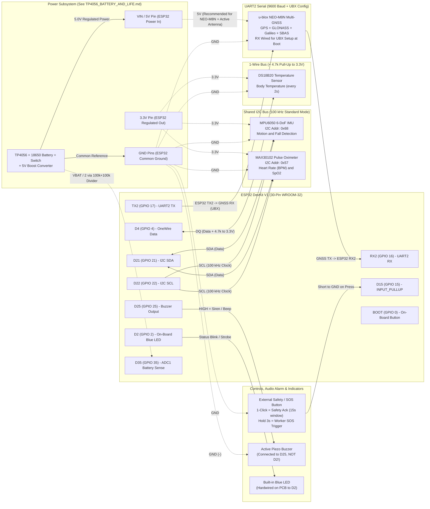

# BeVest Smart IoT Vest — Latest Hardware Wiring & Architecture Diagram (`esp32integration-gnss.ino`)

This document provides the **latest** hardware pinout, complete wiring diagram, sensor bus architecture, LED diagnostics, and cloud telemetry workflow for [`esp32integration-gnss.ino`](./esp32integration-gnss.ino) (**Multi-GNSS Edition** using the **u-blox NEO-M8N**).

> [!NOTE]
> For the dedicated **TP4056 USB-C Charger + 18650 Battery + 5V Boost + Voltage Divider Wiring** and **Step-by-Step Battery Life Calculations**, see the separate power guide: [`TP4056_BATTERY_AND_LIFE.md`](./TP4056_BATTERY_AND_LIFE.md) (and [`BATTERY_SOC_IMPLEMENTATION.md`](../../BATTERY_SOC_IMPLEMENTATION.md) for the ADC SoC firmware snippet).

---

## 1. Latest Complete Hardware Wiring Diagram (Mermaid)



---

## 2. Pin-by-Pin Hardware Mapping Table

| Component | Component Pin | ESP32 Label | ESP32 GPIO | Protocol / Mode | Latest Firmware Notes |
| :--- | :--- | :--- | :--- | :--- | :--- |
| **Power Input** *(from TP4056 + Boost)* | `VOUT+` (`5.0V`) | **`VIN`** (`5V`) | — | Regulated `5V` Supply | Powers ESP32 onboard `3.3V` LDO and NEO-M8N |
| | `OUT-` / `VOUT-` | **`GND`** | — | Common Ground | **Must** come from `TP4056 OUT-` (not `B-`) |
| **Battery SoC Sense** *(Optional ADC Add-On)* | Divider Midpoint (`100k/100k + 100nF`) | **`D35`** | `GPIO 35` | `ADC1_CH7` (`11dB`, `12-bit`) | Scaled `0–2.10V`; see [`TP4056_BATTERY_AND_LIFE.md`](./TP4056_BATTERY_AND_LIFE.md) |
| **u-blox NEO-M8N** *(Multi-GNSS)* | `VCC` | **`VIN`** (`5V`) | — | Power (`5V` / `3.3V` LDO) | `5V` (`VIN`) recommended for active GNSS antenna (per `test_gnss.ino`) |
| | `GND` | **`GND`** | — | Ground | Common Ground |
| | `TX` | **`RX2`** (`D16`) | `GPIO 16` | UART2 RX (`9600 baud`) | Receives `$GNGGA` / `$GNRMC` NMEA (`2048 B` RX buffer) |
| | `RX` | **`TX2`** (`D17`) | `GPIO 17` | UART2 TX (`9600 baud`) | **Required:** sends UBX commands (`GPS+GLONASS+Galileo+SBAS`, `1 Hz`, Flash save) |
| **MPU6050** *(Motion & Fall)* | `VCC` | **`3V3`** | — | Power (`3.3V`) | Range: `±8g` accel, `±500°/s` gyro, `21 Hz` DLPF |
| | `GND` | **`GND`** | — | Ground | |
| | `SDA` | **`D21`** | `GPIO 21` | I²C Data (`100 kHz`) | Address `0x68` (`AD0` = LOW); `25 ms` I²C timeout auto-recovery |
| | `SCL` | **`D22`** | `GPIO 22` | I²C Clock (`100 kHz`) | Shares bus with MAX30102 |
| **MAX30102** *(Heart Rate & $\text{SpO}_2$)* | `VIN` | **`3V3`** | — | Power (`3.3V`) | Initialized with `I2C_SPEED_STANDARD` (`100 kHz`) for stability |
| | `GND` | **`GND`** | — | Ground | |
| | `SDA` | **`D21`** | `GPIO 21` | I²C Data (`100 kHz`) | Address `0x57`; Red=`0x0A`, IR=`0x1F`, Finger IR threshold `>= 50000` |
| | `SCL` | **`D22`** | `GPIO 22` | I²C Clock (`100 kHz`) | Polled every `20 ms`; `4`-beat moving average |
| **DS18B20** *(Body Temp)* | `VDD` (Red) | **`3V3`** | — | Power (`3.3V`) | External **$4.7\text{ k}\Omega$ pull-up resistor** between `DQ` and `3V3` required |
| | `GND` (Black) | **`GND`** | — | Ground | |
| | `DQ` (Yellow) | **`D4`** | `GPIO 4` | OneWire Digital | Non-blocking conversion (`setWaitForConversion(false)`), polled every `2s` |
| **Safety / SOS Button** *(External)* | Pin 1 | **`D15`** | `GPIO 15` | `INPUT_PULLUP` | **1-Click (<15s):** Acknowledges Safety Check (`ACKNOWLEDGED`) & silences buzzer.<br>**Hold 3s:** Sends Worker SOS Trigger (`EMERGENCY_REQUESTED`) & sounds `5s` alarm |
| | Pin 2 | **`GND`** | — | Ground | Active-LOW (`LOW` when pressed) |
| **BOOT Button** *(Factory Reset)* | Built-in PCB | **`BOOT`** | `GPIO 0` | `INPUT_PULLUP` | Hold **3 seconds** to wipe NVS (`bevest`) & enter BLE Pairing Mode |
| **EN / RST Button** *(Double-Tap Reset)* | Built-in PCB | **`EN`** | — | Hardware Reset + RTC Flag | **Double-press within 2.5s** to wipe NVS & enter BLE Pairing Mode |
| **Built-in Blue LED** *(Status)* | Built-in PCB | **`D2`** | `GPIO 2` | Digital `OUTPUT` | Hardwired to PCB `D2`; displays 8 diagnostic blink patterns |
| **Active Buzzer** *(Siren)* | `+` (Signal) | **`D25`** | `GPIO 25` | Digital `OUTPUT` | **Must stay on `D25` (NOT `D2`)** so LED blinks silently and BLE stays quiet |
| | `-` (GND) | **`GND`** | — | Ground | `100 ms` toggle siren during falls, vital alerts, safety checks, or SOS |

---

## 3. Physical ESP32 DevKit V1 (30-Pin) Pin Layout

```text
                             +---------------------------+
                             |      [Micro-USB / C]      |
                             +---------------------------+
     (MPU6050/MAX/DS18B20) 3V3 | 1                      30 | VIN (5V <- Boost / USB, -> NEO-M8N VCC)
          (Common Ground)  GND | 2                      29 | GND (<- TP4056 OUT- & All Sensor GNDs)
  (Safety / SOS Button) <- D15 | 3                      28 | D13
        (DS18B20 DQ)    <- D4  | 4                      27 | D12
        (Blue LED PCB)  <- D2  | 5   ⚠️ DO NOT WIRE     26 | D14
     (NEO-M8N TX ->)   <- RX2  | 6      BUZZER TO D2    25 | D27
     (NEO-M8N RX <-)   <- TX2  | 7      USE D25!        24 | D26
                           D5  | 8                      23 | D25 -> ACTIVE BUZZER (+)
                           D18 | 9                      22 | D33
                           D19 | 10                     21 | D32
  (I2C SDA @ 100kHz)   <- D21  | 11 (MPU6050 + MAX30102)20 | D35 <- Battery Voltage Divider (Optional SoC)
                           RX0 | 12 (Serial Debug)      19 | D34
                           TX0 | 13 (Serial Debug)      18 | VN (GPIO 39)
  (I2C SCL @ 100kHz)   <- D22  | 14 (MPU6050 + MAX30102)17 | VP (GPIO 36)
                           D23 | 15                     16 | EN (Double-Tap <2.5s = Wi-Fi Reset)
                             +---------------------------+
```

> [!CAUTION]
> **Critical Wiring Rules for Reliability:**
> 1. **I²C Speed (`100 kHz`)**: Keep `MPU6050` and `MAX30102` jumper leads short. `esp32integration-gnss.ino` locks the bus to `100 kHz` (`I2C_SPEED_STANDARD`) with a `25 ms` timeout to avoid bus hangs during sudden movement/fall tests.
> 2. **Wire Both `RX2` and `TX2` on the NEO-M8N**: Unlike NMEA-only GPS setups, `esp32integration-gnss.ino` transmits UBX binary packets over `GPIO 17 (TX2)` on startup to activate concurrent **GPS + GLONASS + Galileo + SBAS** (`32` tracking channels).
> 3. **Never Bypass `OUT-` on TP4056**: Always tie ESP32 `GND` to TP4056 `OUT-` (not `B-`) so the onboard `DW01A` protection IC guards the battery. See [`TP4056_BATTERY_AND_LIFE.md`](./TP4056_BATTERY_AND_LIFE.md).

---

## 4. On-Board Blue LED (`GPIO 2`) Diagnostic Patterns

| LED Pattern | System State | Description |
| :--- | :--- | :--- |
| **Slow Blink** (`500 ms ON / 500 ms OFF`) | BLE Pairing Mode | Waiting for BeVest Mobile App (`BEVEST-<CLEAN_MAC>`) |
| **Solid ON** | BLE Connected | Phone connected over BLE GATT for Wi-Fi provisioning |
| **Fast Blink** (`120 ms ON / 120 ms OFF`) | Normal Telemetry | Connected to Wi-Fi & Firebase RTDB; streaming active |
| **2 Blinks / 2s** | Wi-Fi Error | Saved Wi-Fi unreachable; auto-enables BLE fallback |
| **3 Blinks / 2s** | Firebase Error | Wi-Fi OK, cannot reach/auth with Firebase |
| **4 Blinks / 2s** | Sensor Error | `MPU6050` not responding on I²C (`GPIO 21 / 22`) |
| **5 Blinks / 2s** | Power Warning | Low voltage / powerbank sag warning |
| **Rapid Double-Strobe** | Emergency Active | Fall detected, SOS triggered (`D15`), or buzzer alarm active |

---

## 5. Latest Firmware Execution & Cloud Dataflow (`esp32integration-gnss.ino`)


