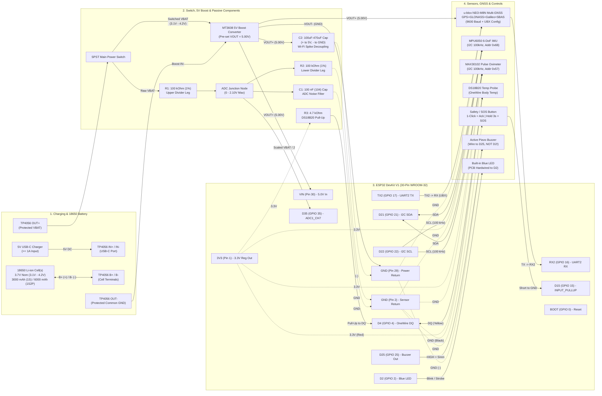
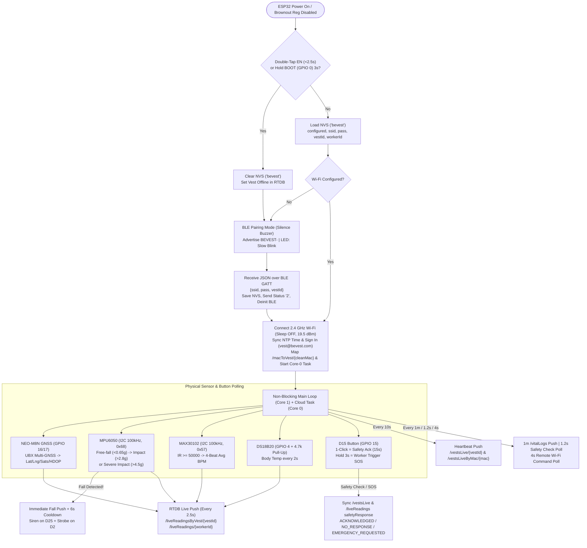

# BeVest Smart IoT Vest — Complete Hardware Wiring, TP4056 Power & Battery Life Guide (`esp32integration-gnss.ino`)

This unified hardware reference covers the **complete end-to-end wiring** for [`esp32integration-gnss.ino`](./esp32integration-gnss.ino) (**Multi-GNSS Edition**), including the **TP4056 USB-C charger**, **18650 Li-ion battery**, **5V boost converter (`MT3608`)**, **every resistor and capacitor connection**, **all sensors & controls**, **battery SoC math**, **battery life & charge-time calculations**, and the **cloud telemetry dataflow**.

---

## 1. Complete End-to-End Wiring Diagram (Mermaid)



---

## 2. Physical Circuit Schematics (ASCII)

### A. TP4056 + 18650 Battery + Switch + MT3608 5V Boost + Resistors & Capacitors

```text
                          5V USB-C Charger (>= 1A)
                                     |
                                     v  (USB-C: IN+ / IN-)
+--------------------+        +--------------------+
| 18650 Li-ion Cell  |   (+)  |   TP4056 MODULE    |
| 3.7V (3.1V - 4.2V) +------->| B+ (DW01A+FS8205A) |---> OUT+ ---> [ SPST Power Switch ] ---> SW_VBAT+ (3.1V-4.2V)
| e.g. 3000 mAh      |   (-)  | B-                 |
+--------------------+------->|                    |---> OUT- ------------------------------> PROTECTED COMMON GND
                              +--------------------+                                          (NEVER use B- for GND!)

──────────────────────────────────────────────────────────────────────────────────────────────────────────────────────
BRANCH 1 — BATTERY VOLTAGE DIVIDER (Tapped at SW_VBAT+, BEFORE the 5V Boost Converter)
──────────────────────────────────────────────────────────────────────────────────────────────────────────────────────

  SW_VBAT+ (3.1V-4.2V) ───► [ R1: 100 kΩ (1%) ] ───┬───────────────────────────────────► ESP32 D35 (GPIO 35 / ADC1_CH7)
                                                   │                                     (Reads 1.55V - 2.10V safely)
                                            ┌──────┴──────┐
                                            │             │
                                    [ R2: 100 kΩ ]  [ C1: 100 nF (104) ]
                                            │             │
                                            └──────┬──────┘
                                                   │
  PROTECTED COMMON GND (TP4056 OUT-) ──────────────┴───────────────────────────────────► ESP32 GND (Pin 2)
                                                                                         (Sensor / ADC Ground)

──────────────────────────────────────────────────────────────────────────────────────────────────────────────────────
BRANCH 2 — MT3608 5V BOOST CONVERTER + C2 BULK CAPACITOR (Pre-adjust VOUT to 5.00V BEFORE connecting ESP32!)
──────────────────────────────────────────────────────────────────────────────────────────────────────────────────────

                                    +----------------------------+
  SW_VBAT+ (3.1V-4.2V) ────────────►| IN+    MT3608 5V BOOST     |
                                    |        (Set to 5.00V!)     |─── VOUT+ (5.00V) ──┬──► ESP32 VIN (Pin 30)
                                    |                            |                    │    + NEO-M8N VCC (5V)
                                    |                            |                   (+)
                                    |                            |            [ C2: 100-470 µF ]
                                    |                            |            [ 10V-16V Elect. ]
                                    |                            |                   (-)
  PROTECTED COMMON GND (OUT-) ─────►| IN-                        |─── VOUT- (GND) ────┴──► ESP32 GND (Pin 29)
                                    +----------------------------+                         + NEO-M8N GND
                                                                                           + Active Buzzer (-)
```

### B. DS18B20 `4.7 kΩ` Pull-Up Resistor & 30-Pin ESP32 DevKit V1 Pinout

```text
   DS18B20 Pull-Up Detail:
   ESP32 3V3 (Pin 1) ──┬─────────────────────► DS18B20 VDD (Red)
                       │
                 [ R3: 4.7kΩ ]
                       │
   ESP32 D4 (GPIO 4) ──┴─────────────────────► DS18B20 DQ  (Yellow)
   ESP32 GND (Pin 2) ────────────────────────► DS18B20 GND (Black)


                             +---------------------------+
                             |      [Micro-USB / C]      |
                             +---------------------------+
 (MPU/MAX/DS18B20/R3)    3V3 | 1                      30 | VIN (<- Boost 5.0V / C2+ -> NEO-M8N VCC)
 (Sensor/Btn/R2/C1 GND)  GND | 2                      29 | GND (<- Boost VOUT-/C2- -> NEO-M8N/Buzzer-)
  (Safety / SOS Button) <- D15| 3                     28 | D13
 (DS18B20 DQ + R3 4.7k) <- D4 | 4                     27 | D12
        (Blue LED PCB)  <- D2 | 5  ⚠️ DO NOT WIRE     26 | D14
     (NEO-M8N TX ->)   <- RX2 | 6     BUZZER TO D2    25 | D27
     (NEO-M8N RX <-)   <- TX2 | 7     USE D25!        24 | D26
                           D5 | 8                     23 | D25 -> ACTIVE BUZZER (+)
                           D18| 9                     22 | D33
                           D19| 10                    21 | D32
  (I2C SDA @ 100kHz)   <- D21 | 11 (MPU6050+MAX30102) 20 | D35 <- R1/R2/C1 Battery Divider Node
                           RX0| 12 (Serial Debug)     19 | D34
                           TX0| 13 (Serial Debug)     18 | VN (GPIO 39)
  (I2C SCL @ 100kHz)   <- D22 | 14 (MPU6050+MAX30102) 17 | VP (GPIO 36)
                           D23| 15                    16 | EN (Double-Tap <2.5s = Wi-Fi Reset)
                             +---------------------------+
```

> [!NOTE]
> **About ESP32's Two `GND` Pins (Pin 2 & Pin 29):** Both `GND` pins are internally shorted (`0 Ω`) on the ESP32 PCB copper ground plane. Grouping high-current return wires (`Boost VOUT-`, `NEO-M8N GND`, `Buzzer -`, `C2 -`) on **Pin 29** and low-noise sensor/ADC returns (`MPU6050`, `MAX30102`, `DS18B20`, `SOS Button`, `R2`, `C1`) on **Pin 2** reduces ground bounce on I²C and `GPIO 35` ADC readings.

---

## 3. Exact Resistor & Capacitor Wiring Table

| Part ID | Value / Marking | Polarity | Terminal 1 (`+`) Connects To | Terminal 2 (`-`) Connects To | Purpose |
| :---: | :--- | :---: | :--- | :--- | :--- |
| **`R1`** | `100 kΩ` (`1%` metal film) | Non-polarized | **SPST Switch Output (`SW_VBAT+`)** *(pre-boost `3.1V–4.2V`)* | **ADC Junction Node → `ESP32 D35 (GPIO 35)`** | Upper leg of `2:1` battery voltage divider |
| **`R2`** | `100 kΩ` (`1%` metal film) | Non-polarized | **ADC Junction Node → `ESP32 D35 (GPIO 35)`** | **`ESP32 GND (Pin 2)` / `TP4056 OUT-`** | Lower leg of `2:1` divider (halves `4.2V` to `2.1V`; draws only `21 µA`) |
| **`C1`** | `100 nF` (`0.1 µF`, code `104` ceramic) | Non-polarized | **ADC Junction Node → `ESP32 D35 (GPIO 35)`** | **`ESP32 GND (Pin 2)` / `TP4056 OUT-`** | Filters Wi-Fi TX noise spikes in parallel with `R2` |
| **`R3`** | `4.7 kΩ` (`1/4 W`) | Non-polarized | **`ESP32 3V3 (Pin 1)`** *(DS18B20 `VDD` Red)* | **`ESP32 D4 (GPIO 4)`** *(DS18B20 `DQ` Yellow)* | Mandatory 1-Wire bus pull-up for reliable `DS18B20` reads |
| **`C2`** | `100 µF – 470 µF` (`10V–16V` electrolytic, *Recommended*) | **Polarized** *(Long leg = `+`, Stripe = `-`)* | **`+` → `ESP32 VIN (Pin 30)` / Boost `VOUT+` (`5.0V`)** | **`-` → `ESP32 GND (Pin 29)` / Boost `VOUT-`** | Bulk reservoir cap; absorbs `250–350 mA` Wi-Fi TX bursts to prevent brownout |

*(I²C pull-up resistors on `GPIO 21 / 22` are already built into standard `MPU6050` and `MAX30102` breakout modules — no extra external I²C resistors are needed.)*

---

## 4. Complete Pin-by-Pin Hardware Mapping Table

| Module / Component | Component Pin | Connects To (ESP32 / Power) | ESP32 GPIO | Protocol / Mode | Latest Firmware Notes |
| :--- | :--- | :--- | :---: | :--- | :--- |
| **18650 Battery** | `+` / `-` | `TP4056 B+` / `TP4056 B-` | — | `3.1V – 4.2V` (1S) | Never connect load directly to `B+`/`B-` |
| **TP4056 Charger** *(DW01A+8205A)* | `IN+` / `IN-` (USB-C) | `5V` USB-C Adapter (`>= 1A`) | — | `1000 mA` CC/CV Charge | Red LED = Charging; Blue/Green = Full |
| | `OUT+` | `SPST Switch` → Boost `IN+` & `R1` | — | Protected `VBAT` | Over-discharge & short protection active |
| | `OUT-` | Boost `IN-` → `ESP32 GND` (Pin 29) | — | Protected Common `GND` | **Never** substitute `B-` for `OUT-` |
| **MT3608 5V Boost** | `IN+` / `IN-` | Switch Out (`SW_VBAT+`) / `TP4056 OUT-` | — | `3.1V–4.2V` Input | Pre-adjust output to `5.00V` before wiring ESP32 |
| | `VOUT+` / `VOUT-` | **`VIN` (Pin 30)** & `NEO-M8N VCC` / **`GND` (Pin 29)** | — | `5.00V` Regulated | Add `C2` (`100–470 µF`) across `VOUT+`/`VOUT-` |
| **Battery SoC Divider** | `R1`/`R2`/`C1` Node | **`D35`** | `GPIO 35` | `ADC1_CH7` (`11dB`, `12-bit`) | Scaled `0–2.10V`; tapped **before** Boost |
| **u-blox NEO-M8N** *(Multi-GNSS)* | `VCC` / `GND` | **`VIN` (`5V`)** / **`GND` (Pin 29)** | — | `5V` Power | `5V` recommended for active patch antenna (`test_gnss.ino`) |
| | `TX` | **`RX2`** (`D16`) | `GPIO 16` | UART2 RX (`9600`) | Receives `$GNGGA` / `$GNRMC` (`2048 B` buffer) |
| | `RX` | **`TX2`** (`D17`) | `GPIO 17` | UART2 TX (`9600`) | **Required:** sends UBX Multi-GNSS config at boot |
| **MPU6050** *(Motion & Fall)* | `VCC` / `GND` | **`3V3` (Pin 1)** / **`GND` (Pin 2)** | — | `3.3V` Power | `±8g` accel, `±500°/s` gyro, `21 Hz` DLPF |
| | `SDA` / `SCL` | **`D21`** / **`D22`** | `21` / `22` | I²C (`100 kHz`) | Address `0x68` (`AD0`=LOW); `25 ms` timeout |
| **MAX30102** *(Heart Rate)* | `VIN` / `GND` | **`3V3` (Pin 1)** / **`GND` (Pin 2)** | — | `3.3V` Power | Shares I²C bus (`I2C_SPEED_STANDARD`, `100 kHz`) |
| | `SDA` / `SCL` | **`D21`** / **`D22`** | `21` / `22` | I²C (`100 kHz`) | Address `0x57`; Red=`0x0A`, IR=`0x1F`, Finger `IR >= 50000` |
| **DS18B20** *(Body Temp)* | `VDD` (Red) / `GND` (Black) | **`3V3` (Pin 1)** / **`GND` (Pin 2)** | — | `3.3V` Power | Polled every `2s` non-blocking |
| | `DQ` (Yellow) | **`D4`** (+ `R3` `4.7 kΩ` to `3V3`) | `GPIO 4` | OneWire Digital | Requires external `4.7 kΩ` pull-up resistor |
| **Safety / SOS Button** | Pin 1 / Pin 2 | **`D15`** / **`GND` (Pin 2)** | `GPIO 15` | `INPUT_PULLUP` | **1-Click (<15s):** `ACKNOWLEDGED` Safety Ack<br>**Hold 3s:** `EMERGENCY_REQUESTED` Worker SOS |
| **BOOT Button** | Built-in PCB | **`BOOT`** | `GPIO 0` | `INPUT_PULLUP` | Hold **3s** = Factory Reset (wipes NVS `bevest`) |
| **EN / RST Button** | Built-in PCB | **`EN`** | — | Hardware Reset + RTC | **Double-tap < 2.5s** = Factory Reset & BLE Pairing |
| **Built-in Blue LED** | Built-in PCB | **`D2`** | `GPIO 2` | Digital `OUTPUT` | Hardwired to `D2`; 8 diagnostic blink patterns |
| **Active Buzzer** | `+` / `-` | **`D25`** / **`GND` (Pin 29)** | `GPIO 25` | Digital `OUTPUT` | **Must stay on `D25` (NOT `D2`)**; silent during BLE |

---

## 5. Critical Hardware Safety & Wiring Rules

1. **Always Connect Load & Ground to `TP4056 OUT+` / `OUT-` (Never `B+` / `B-`)**:
   - On protected TP4056 modules, `FS8205A` protection MOSFETs sit between `B-` and `OUT-`. Tying system `GND` to `B-` disables over-discharge (`< 2.5V`) and short-circuit protection.
2. **Pre-Adjust the MT3608 Boost Converter to `5.00 V` First**:
   - Connect battery → TP4056 → Switch → MT3608 **without** the ESP32 attached. Measure `VOUT+`/`VOUT-` with a multimeter and turn the trimpot until it reads **`5.00 V`**. (Some MT3608 boards ship adjusted above `12V`—connecting an unadjusted board will destroy the ESP32 and NEO-M8N!)
3. **Turn the SPST Power Switch OFF While Charging**:
   - Standard TP4056 boards lack a MOSFET load-sharing power path. Leaving the vest ON draws `~300 mA` from `OUT+`, preventing the TP4056 from detecting charge termination (`100 mA`). Flip the switch **OFF** while charging via USB-C.
4. **Tap the ADC Divider (`R1`) BEFORE the Boost Converter & Use `ADC1` Only**:
   - `R1` must connect to `SW_VBAT+` (`3.1V–4.2V`), **never** the regulated `5.00V` boost output.
   - Use **`GPIO 35` (`ADC1`)** only — ESP32 Wi-Fi locks `ADC2` pins permanently while active.
5. **Parallel Cells (`1S2P`) Only — Never Series (`2S`) on TP4056**:
   - TP4056 is strictly **1S (`4.2V`)**. If wiring two 18650 cells in parallel (`6000 mAh`), match cell models and bring both cells within `<= 0.05 V` before joining them.
6. **Keep I²C at `100 kHz` & Wire Both `RX2` + `TX2` on NEO-M8N**:
   - `esp32integration-gnss.ino` locks I²C to `100 kHz` (`I2C_SPEED_STANDARD`) with a `25 ms` timeout for vest-wire stability, and uses `GPIO 17 (TX2)` at boot to transmit UBX binary packets enabling concurrent **GPS + GLONASS + Galileo + SBAS**.

---

## 6. Battery State of Charge (SoC) & Voltage Divider Math

With $R_1 = 100\text{ k}\Omega$ and $R_2 = 100\text{ k}\Omega$:

$$V_{\text{ADC}} = V_{\text{bat}} \times \frac{R_2}{R_1 + R_2} = 0.5 \times V_{\text{bat}}, \qquad V_{\text{bat}} = V_{\text{ADC}} \times 2.0$$

| 18650 Cell Voltage ($V_{\text{bat}}$) | `GPIO 35` Pin Voltage ($V_{\text{ADC}}$) | Estimated SoC (%) | Status |
| :---: | :---: | :---: | :--- |
| $\ge 4.18\text{ V}$ | $2.09\text{ V}$ | **100%** | Full Charge |
| $3.95\text{ V}$ | $1.975\text{ V}$ | **80%** | Normal |
| $3.78\text{ V}$ | $1.89\text{ V}$ | **60%** | Nominal Plateau |
| $3.73\text{ V}$ | $1.865\text{ V}$ | **50%** | Nominal Plateau |
| $3.62\text{ V}$ | $1.81\text{ V}$ | **30%** | Warning |
| $3.55\text{ V}$ | $1.775\text{ V}$ | **20%** | Low Battery Alert |
| $3.30\text{ V}$ | $1.65\text{ V}$ | **5%** | Critical — Recharge Now |
| $\le 3.10\text{ V}$ | $1.55\text{ V}$ | **0%** | Cutoff Threshold |

> [!TIP]
> For the 32-sample oversampling + `0.20` EMA filter + multimeter `ADC_REF_CALIBRATION` code block, see [`BATTERY_SOC_IMPLEMENTATION.md`](../../BATTERY_SOC_IMPLEMENTATION.md).

---

## 7. Calculating the Battery Life & Charge Time

### Step 1: Component Current Budget (`esp32integration-gnss.ino`)

With `WiFi.setSleep(false)`, `WIFI_POWER_19_5dBm`, concurrent Multi-GNSS (`1 Hz`), `20 ms` I²C polling, and `2.5 s` Firebase TLS pushes:

| Component | Firmware Configuration | Active Range | Typical Avg (`5V` Rail) | Notes |
| :--- | :--- | :---: | :---: | :--- |
| **ESP32-WROOM-32 DevKit V1** | Wi-Fi active, `setSleep(false)`, `19.5 dBm`, TLS `2.5s` + polls + board LDO/USB IC | `95 – 350 mA` | **`135.0 mA`** | TX bursts up to `~350 mA` |
| **u-blox NEO-M8N Multi-GNSS** | Continuous `1 Hz` (GPS+GLONASS+Galileo+SBAS) + active antenna | `35 – 65 mA` | **`45.0 mA`** | Higher during cold fix |
| **MPU6050 6-DoF IMU** | Accel + gyro polled every `20 ms` (`100 kHz` I²C) | `3.6 – 4.5 mA` | **`4.0 mA`** | Includes module LDO |
| **MAX30102 Pulse Oximeter** | Red=`0x0A`, IR=`0x1F` pulsed @ `20 ms` | `1.5 – 5.0 mA` | **`3.0 mA`** | Pulsed LEDs + module LDO |
| **DS18B20 Thermometer** | Async conversion every `2000 ms` (`4.7kΩ` pull-up) | `< 0.1 – 1.5 mA` | **`0.5 mA`** | `~750 ms` active / `2s` |
| **Built-in Blue LED (`D2`)** | Fast blink (`120 ms` ON / `120 ms` OFF = `50%`) | `0 – 6 mA` | **`3.0 mA`** | Status indicator |
| **Active Buzzer (`D25`)** | Idle normally (`~25 mA` pulsed during alarms) | `0 / 25 mA` | **`0.0 mA`** *(idle)* | Minimal average if idle |
| **Divider (`R1 + R2`)** | $200\text{ k}\Omega$ across `SW_VBAT+` | `0.021 mA` | **`~0.0 mA`** | Battery-side (`21 µA`) |
| **Total Steady Load ($I_{\text{load,5V}}$)** | **Continuous Tracking Mode** | — | **`~190 mA`** | $P_{\text{load}} = 5.0\text{ V} \times 0.190\text{ A} = 0.950\text{ W}$ |

### Step 2: Boost-Compensated Battery Life Formula

Because the MT3608 steps `3.7 V` nominal up to `5.0 V` at efficiency $\eta \approx 0.85$ (`85%`), actual current drained from the 18650 cell is:

$$I_{\text{bat,avg}} = \frac{V_{\text{out}} \times I_{\text{load}}}{V_{\text{bat,nom}} \times \eta} = \frac{5.0\text{ V} \times 190\text{ mA}}{3.7\text{ V} \times 0.85} = \frac{950}{3.145} \approx \mathbf{302.1\text{ mA}}$$

Using usable Depth of Discharge $\text{DoD} = 0.90$ (`90%` nominal down to `3.1V–3.3V` cutoff; or `0.80` conservative for aged/hot cells):

$$\text{Battery Life (Hours)} = \frac{C_{\text{rated}} \times \text{DoD}}{I_{\text{bat,avg}}} = \frac{C_{\text{rated}} \times V_{\text{bat,nom}} \times \text{DoD} \times \eta}{V_{\text{out}} \times I_{\text{load}}}$$

### Step 3: Worked Runtime Estimates

| Battery Pack (`3.7 V` Nominal) | Usable (`90%` DoD) | Cell Drain ($I_{\text{bat}}$) | Estimated Runtime (`90%` DoD) | Conservative (`80%` DoD) |
| :--- | :---: | :---: | :---: | :---: |
| **1× 18650 (`2000 mAh`) + TP4056 + 5V Boost** | `1800 mAh` | `~302 mA` | **~6.0 hours** | ~5.3 hours |
| **1× 18650 (`2600 mAh`) + TP4056 + 5V Boost** | `2340 mAh` | `~302 mA` | **~7.7 hours** | ~6.9 hours |
| **1× 18650 (`3000 mAh`) + TP4056 + 5V Boost** | `2700 mAh` | `~302 mA` | **~8.9 hours** | ~7.9 hours |
| **2× 18650 `1S2P` (`6000 mAh`) + TP4056 + 5V Boost** | `5400 mAh` | `~302 mA` | **~17.9 hours** | ~15.9 hours |
| **BLE Pairing Mode Only (Wi-Fi Off, `3000 mAh`)** | `2700 mAh` | `~145 mA` | **~18.6 hours** | ~16.5 hours |
| **USB Powerbank (`10,000 mAh` internal `3.7 V`)** | `9000 mAh` | `~302 mA` | **~29.8 hours** | ~26.5 hours |

*Example (`3000 mAh` cell):*
$$\text{Runtime} = \frac{3000\text{ mAh} \times 0.90}{302.1\text{ mA}} = \frac{2700}{302.1} \approx \mathbf{8.94\text{ hours}} \quad (\approx \text{8 hr 56 min})$$

### Step 4: TP4056 Charging Time Calculation

TP4056 charge current is set by $R_{\text{PROG}}$ (`1.2 kΩ` board default = `1000 mA`), with a `1.20×` CC/CV taper factor:

$$I_{\text{charge}}\text{ (mA)} = \frac{1200}{R_{\text{PROG}}\text{ (k}\Omega\text{)}}, \qquad T_{\text{charge}}\text{ (hours)} \approx \frac{C_{\text{mAh}}}{I_{\text{charge}}\text{ (mA)}} \times 1.20$$

| $R_{\text{PROG}}$ Resistor | Charge Current | `2000 mAh` Cell | `3000 mAh` Cell | `6000 mAh` (`1S2P`) |
| :---: | :---: | :---: | :---: | :---: |
| **`1.2 kΩ` *(Default)*** | **`1000 mA` (`1.0 A`)** | **~2.4 hours** | **~3.6 hours** | **~7.2 hours** |
| `1.5 kΩ` | `~800 mA` | ~3.0 hours | ~4.5 hours | ~9.0 hours |
| `2.4 kΩ` *(Cooler)* | `500 mA` | ~4.8 hours | ~7.2 hours | ~14.4 hours |

### Step 5: Extending Runtime (Optional Firmware Tuning)
- Enable `WiFi.setSleep(true)` to save `~35–50 mA` on the `5V` rail (`+2.0–3.0 hours` on a `3000 mAh` cell).
- Increase `PUSH_INTERVAL_MS` (`2500 ms` → `5000 ms`) while keeping fall interrupts immediate (`pendingFallPush`).
- For bench verification, measure actual $I_{\text{bat,measured}}$ in series with `TP4056 OUT+` during active GNSS lock + Firebase pushes and compute `Runtime = (C_mAh × 0.90) / I_bat,measured`.

---

## 8. On-Board Blue LED (`GPIO 2`) Diagnostic Patterns

| LED Pattern | System State | Description |
| :--- | :--- | :--- |
| **Slow Blink** (`500 ms ON / 500 ms OFF`) | BLE Pairing Mode | Waiting for BeVest Mobile App (`BEVEST-<CLEAN_MAC>`) |
| **Solid ON** | BLE Connected | Phone connected over BLE GATT for Wi-Fi provisioning |
| **Fast Blink** (`120 ms ON / 120 ms OFF`) | Normal Telemetry | Connected to Wi-Fi & Firebase RTDB; streaming active |
| **2 Blinks / 2s** | Wi-Fi Error | Saved Wi-Fi unreachable; auto-enables BLE fallback |
| **3 Blinks / 2s** | Firebase Error | Wi-Fi OK, cannot reach/auth with Firebase |
| **4 Blinks / 2s** | Sensor Error | `MPU6050` not responding on I²C (`GPIO 21 / 22`) |
| **5 Blinks / 2s** | Power Warning | Low voltage / powerbank sag warning |
| **Rapid Double-Strobe** | Emergency Active | Fall detected, SOS triggered (`D15`), or buzzer alarm active |

---

## 9. Firmware Execution & Cloud Dataflow (`esp32integration-gnss.ino`)


