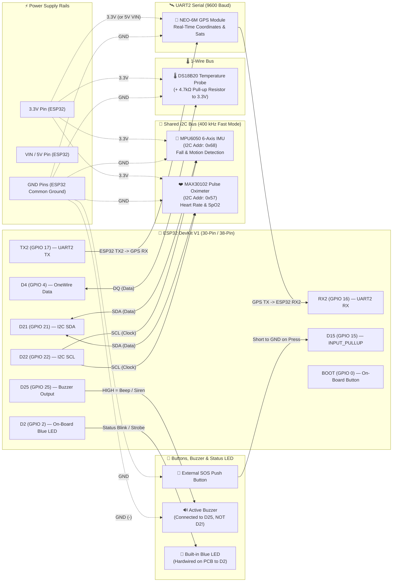
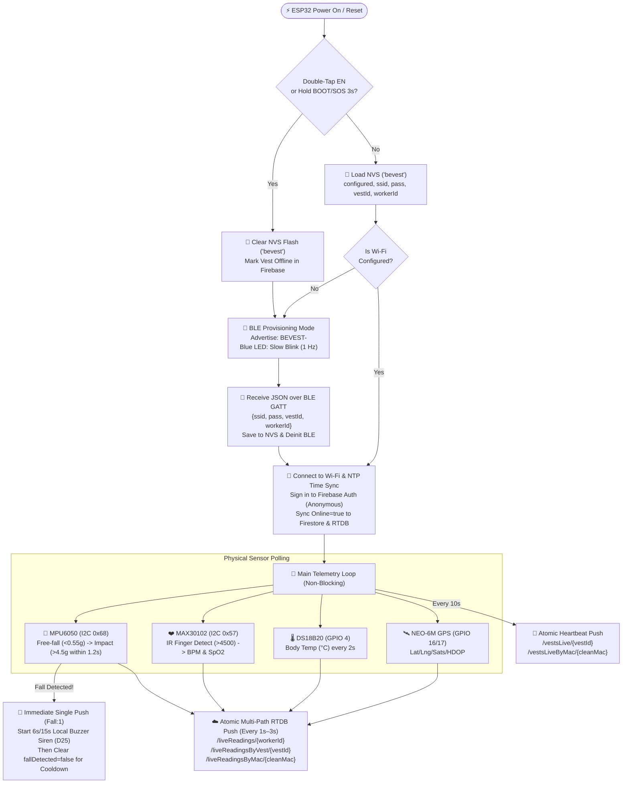

# BeVest Smart IoT Vest — `esp32integration.ino` Hardware Wiring & Architecture Diagram

This document provides the complete hardware pinout, wiring diagram, sensor bus architecture, and firmware workflow for [`esp32integration.ino`](file:///c:/Users/User/Documents/GitHub/BevestV1/firmware/esp32integration/esp32integration.ino).

---

## 1. Complete Hardware Wiring Diagram (Mermaid)



---

## 2. Pin-by-Pin Hardware Mapping Table

| Component | Component Pin | ESP32 Board Label | ESP32 GPIO | Protocol / Mode | Notes |
| :--- | :--- | :--- | :--- | :--- | :--- |
| **MPU6050** *(Fall & Motion)* | `VCC` | `3V3` | — | Power (`3.3V`) | Shares I²C bus with MAX30102 |
| | `GND` | `GND` | — | Ground | |
| | `SDA` | **`D21`** | `GPIO 21` | I²C Data (`400 kHz`) | Address `0x68` (`AD0` = LOW) |
| | `SCL` | **`D22`** | `GPIO 22` | I²C Clock (`400 kHz`) | |
| **MAX30102** *(Heart Rate & $\text{SpO}_2$)* | `VIN` | `3V3` | — | Power (`3.3V`) | Shares I²C bus with MPU6050 |
| | `GND` | `GND` | — | Ground | |
| | `SDA` | **`D21`** | `GPIO 21` | I²C Data (`400 kHz`) | Address `0x57` |
| | `SCL` | **`D22`** | `GPIO 22` | I²C Clock (`400 kHz`) | |
| **NEO-6M GPS** *(Location)* | `VCC` | `VIN` (`5V`) or `3V3` | — | Power | Cross `TX`/`RX` between GPS & ESP32 |
| | `GND` | `GND` | — | Ground | |
| | `TX` | **`RX2` (`D16`)** | `GPIO 16` | UART2 Receive (`9600`) | GPS transmits $\rightarrow$ ESP32 receives |
| | `RX` | **`TX2` (`D17`)** | `GPIO 17` | UART2 Transmit (`9600`) | ESP32 transmits $\rightarrow$ GPS receives |
| **DS18B20** *(Body Temp)* | `VDD` (Red) | `3V3` | — | Power (`3.3V`) | Requires $4.7\text{ k}\Omega$ resistor between `DQ` & `3V3` |
| | `GND` (Black) | `GND` | — | Ground | |
| | `DQ` (Yellow) | **`D4`** | `GPIO 4` | OneWire Digital | |
| **SOS Button** *(Emergency)* | Pin 1 | **`D15`** | `GPIO 15` | `INPUT_PULLUP` | Short press = SOS; Hold 3s = Factory Reset |
| | Pin 2 | `GND` | — | Ground | |
| **BOOT Button** *(Reset)* | Built-in | **`BOOT`** | `GPIO 0` | `INPUT_PULLUP` | Hold 3s (or double-tap `EN`) = Factory Reset |
| **Built-in Blue LED** | Built-in PCB | **`D2`** | `GPIO 2` | Digital `OUTPUT` | Hardwired to `D2` on ESP32 PCB; blinks status |
| **Active Buzzer** *(Audio)* | `+` (Signal) | **`D25`** | `GPIO 25` | Digital `OUTPUT` | **Must be on `D25` (NOT `D2`)** so LED blinks silently! |
| | `-` (GND) | `GND` | — | Ground | |

---

## 3. Physical ESP32 DevKit V1 Pin Layout Diagram

```text
                       +---------------------------+
                       |      [Micro-USB / C]      |
                       +---------------------------+
                   3V3 | 1                      30 | VIN (5V -> GPS VCC)
                   GND | 2                      29 | GND (Common Ground)
      (SOS Btn) <- D15 | 3                      28 | D13
  (Temp DS18B20) <- D4 | 4                      27 | D12
  (Blue LED PCB) <- D2 | 5   ⚠️ DO NOT WIRE     26 | D14
   (GPS TX ->) <- RX2  | 6      BUZZER TO D2    25 | D27
   (GPS RX <-) <- TX2  | 7      USE D25!        24 | D26
                    D5 | 8                      23 | D25 -> 🔊 ACTIVE BUZZER (+)
                   D18 | 9                      22 | D33
                   D19 | 10                     21 | D32
  (I2C SDA Bus) <- D21 | 11 (MPU6050 + MAX30102)20 | D35
                   RX0 | 12                     19 | D34
                   TX0 | 13                     18 | VN (GPIO 39)
  (I2C SCL Bus) <- D22 | 14 (MPU6050 + MAX30102)17 | VP (GPIO 36)
                   D23 | 15                     16 | EN (Double-Tap = Reset)
                       +---------------------------+
```

---

## 4. Firmware Execution & Cloud Dataflow Diagram



